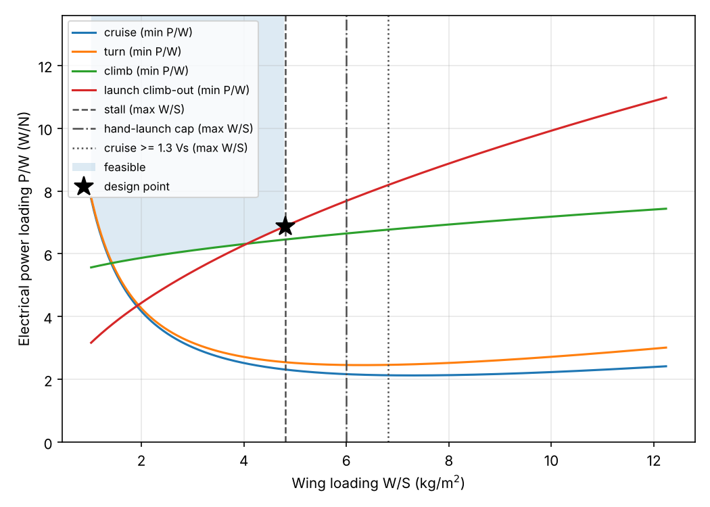

# Manta Mapper

A tailless blended-wing-body (BWB) flying-wing UAV for autonomous aerial
mapping, designed by an automated concept-design pipeline, checked with CFD,
drawn by script in Fusion 360, 3D printed, flown, and then compared against
its own predictions.

**Mission:** map 25 ha (stretch: 50 ha) per flight at 3 cm/px with a Raspberry
Pi Zero 2 W + Camera Module 3, land with 30 % battery left, hand launch, belly
landing, under 400 ft AGL in visual line of sight. Photos go to WebODM for an
orthomosaic, elevation model and 3D model.

## How the design is made

```
mission requirements ─▶ constraint analysis ─▶ parametric BWB geometry
                                                    │
     ┌──────────────── design-to-cost optimizer ◀───┤
     │   aero (NeuralFoil ▶ AeroSandbox VLM), weights, propulsion, stability
     ▼
 VSPAERO on top 2–3 ─▶ CFD on the final design ─▶ Fusion 360 CAD by script
                                                    │
                     print (LW-PLA, carbon spar) ◀──┘ ─▶ fly ─▶ predicted vs measured
```

See [docs/requirements.md](docs/requirements.md) for the numbered requirements
and validation targets, and [docs/plan.md](docs/plan.md) for phases and
milestones.

## Status

Phase 1, milestone 1: requirements and constraint analysis are working.

```bash
pip install -e ".[dev]"
python -m manta_mapper config/mission.toml --plot constraint_diagram.png
pytest
```

The report gives the survey geometry (altitude for 3 cm/px, photo footprint,
trigger interval, flight-line length), the constraint-chart design point
(wing loading and power loading), and a first-cut size for a guessed take-off
mass.



## Repository layout

```
config/mission.toml     the mission, as data
docs/                   requirements, plan, figures
src/manta_mapper/
  requirements.py       mission requirements and first-guess assumptions
  atmosphere.py         ISA atmosphere
  survey.py             GSD, footprint, overlap, flight lines, trigger rate
  constraints.py        wing-loading / power-loading constraint analysis, sizing
  geometry.py, aero.py, weights.py, propulsion.py, stability.py,
  optimize.py, cad.py, validation.py     (placeholders for later milestones)
tests/
```

## Credits

The idea of scripting a UAV concept design end to end was inspired by
openvsp-scripts by prahaas123. All code here is original.

## License

MIT
