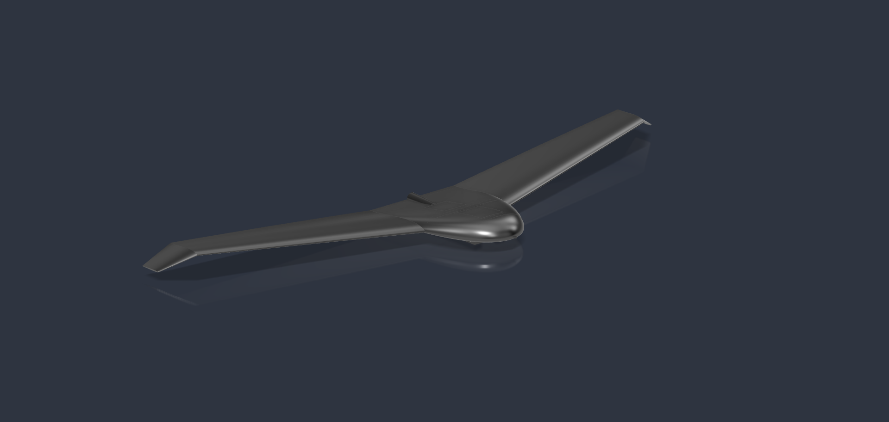
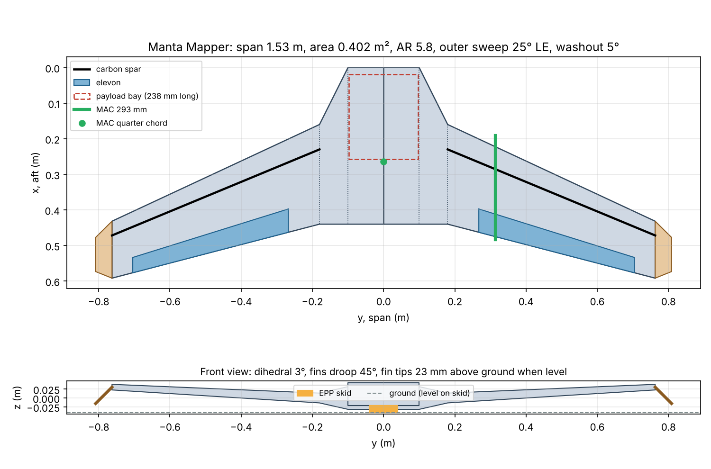

# Manta Mapper

A tailless blended-wing-body (BWB) flying-wing UAV for autonomous aerial
mapping, designed by an automated concept-design pipeline, checked with CFD,
drawn by script in Fusion 360, 3D printed, flown, and then compared against
its own predictions.

**Mission:** map 25 ha (stretch: 50 ha) per flight at 3 cm/px with a Raspberry
Pi Zero 2 W + Camera Module 3, land with 30 % battery left, hand launch, belly
landing, under 400 ft AGL in visual line of sight. Photos go to WebODM for an
orthomosaic, elevation model and 3D model.



## How the design is made

```
mission requirements ─▶ constraint analysis ─▶ parametric BWB geometry
                                                    │
     ┌──────────────── design-to-cost optimizer ◀───┤
     │   aero (NeuralFoil ▶ AeroSandbox VLM), weights, propulsion, stability
     ▼
 VSPAERO on top 2–3 ─▶ CFD on the final design ─▶ Fusion 360 CAD by script
                                                    │
                     print pod, hot-wire panels  ◀──┘ ─▶ fly ─▶ predicted vs measured
```

See [docs/requirements.md](docs/requirements.md) for the numbered requirements
and validation targets, and [docs/plan.md](docs/plan.md) for phases and
milestones.

## Status

Phase 1: requirements and constraint analysis (M1.1), airfoil selection
(M1.2), the parametric geometry (M1.3), the aero and stability analysis
(M1.4), the weights and propulsion (M1.5) and the design-to-cost optimizer (M1.6) are working. The airfoils are S5010
on the outer panels and MH 78 on the centre body; [docs/airfoils.md](docs/airfoils.md)
explains why. [docs/geometry.md](docs/geometry.md) explains every shape
parameter and the baseline: 1.53 m span, 0.40 m² wing, 5° washout.
[docs/aero_stability.md](docs/aero_stability.md) covers aerodynamics and
stability (M1.4): neutral point, CG range, trim, drag, where the stall starts,
flight modes and the camera tilt.
[docs/weights_propulsion.md](docs/weights_propulsion.md) covers weights and
propulsion (M1.5): what every part weighs and where it goes, the motor, prop
and battery, and whether the 25 ha and 50 ha flights make it home with 30 %.
[docs/optimizer.md](docs/optimizer.md) covers the design-to-cost optimizer
(M1.6): ten shape variables, 24 constraints, and an optimum that fixes the
baseline's one weak spot (Dutch roll damping) with margin, 32 g lighter.
[docs/cfd.md](docs/cfd.md) covers the RANS CFD check (M2.1): OpenFOAM on the
real thick shape, which settles the neutral point and brackets cruise drag.
[docs/structures.md](docs/structures.md) covers the spar and the panel joint
(M2.2): load cases from gusts, hand launch, catapult, belly landings and fin
tip strikes, and a telescoping carbon spar sized from off-the-shelf tubes.
[docs/cad.md](docs/cad.md) covers the scripted CAD (M2.3): the pod split into four
half-sections that fit the 300 mm printer, the spar sleeve mounts, hatches,
battery tray, camera, motor nacelle and twin skid rails, automatic payload
packing, EPP hot-wire templates, and a Fusion 360 script that builds it all
from one recipe.

```bash
pip install -e ".[dev]"
python -m manta_mapper config/mission.toml --plot constraint_diagram.png
python -m manta_mapper.airfoils config/mission.toml --plots docs/img
python -m manta_mapper.geometry config/mission.toml --plots docs/img --vsp manta.vspscript
python -m manta_mapper.stability config/mission.toml --plots docs/img --report docs/stability_report.txt
python -m manta_mapper.weights config/mission.toml --plots docs/img --report docs/weights_report.txt
python -m manta_mapper.optimize config/mission.toml --report docs/optimizer_report.txt --json docs/optimizer_result.json --plots docs/img
python -m manta_mapper.structures config/mission.toml --report docs/structures_report.txt --json docs/structures_result.json --plots docs/img
python -m manta_mapper.cad --json cad/manta_cad.json --dxf cad/templates --stl cad/stl --render docs/img/cad_parts.png --report docs/cad_report.txt --plots docs/img
pytest
```

The report gives the survey geometry (altitude for 3 cm/px, photo footprint,
trigger interval, flight-line length), the constraint-chart design point
(wing loading and power loading), and a first-cut size for a guessed take-off
mass.




## Repository layout

```
config/mission.toml     the mission, as data
docs/                   requirements, plan, figures
src/manta_mapper/
  requirements.py       mission requirements and first-guess assumptions
  atmosphere.py         ISA atmosphere
  survey.py             GSD, footprint, overlap, flight lines, trigger rate
  constraints.py        wing-loading / power-loading constraint analysis, sizing
  airfoils.py           reflex airfoil comparison (NeuralFoil), gates, scores, plots
  geometry.py           parametric BWB: AeroSandbox model, reference values, checks, OpenVSP export
  aero.py               VLM + NeuralFoil strip drag, trim, stall (M1.4)
  stability.py          neutral point, CG band, flight modes, camera tilt (M1.4)
  propulsion.py         prop (BEMT), motor, Li-ion pack, parts search, mission energy (M1.5)
  weights.py            weight build-up, CG placement, inertia, M1.5 report (M1.5)
  optimize.py           design-to-cost optimizer: screen + COBYLA, coarse/full VLM (M1.6)
  structures.py         load cases, telescoping spar sizing, sleeve and carry-through (M2.2)
  cad.py                scripted CAD: print split, sleeve mounts, hatches, tray, packing, checks, recipe (M2.3)
  cad_mesh.py           builds the CAD recipe as meshes (manifold3d): STLs, masses, fit checks (M2.3)
  cad_templates.py      DXF hot-wire templates for the EPP panels, fins and skid (M2.3)
  validation.py         (placeholder for a later milestone)
cad/
  fusion/MantaMapperCAD/  Fusion 360 script that builds the parts from cad/manta_cad.json
  manta_cad.json, stl/, templates/   generated recipe, printable STLs, DXF templates
tests/
```

## Credits

The idea of scripting a UAV concept design end to end was inspired by
openvsp-scripts by prahaas123. All code here is original.

## License

MIT
