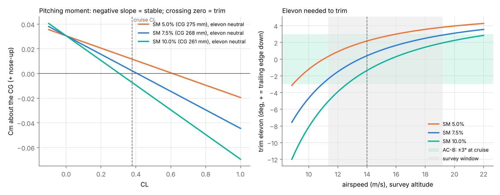
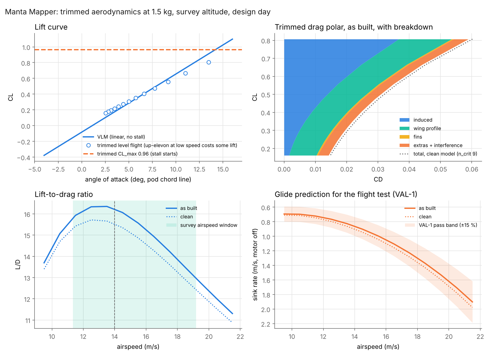
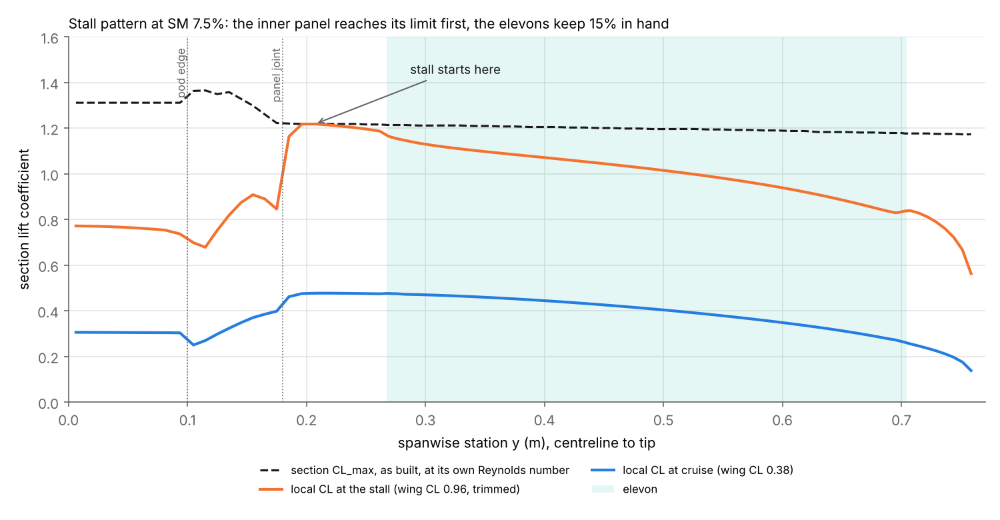
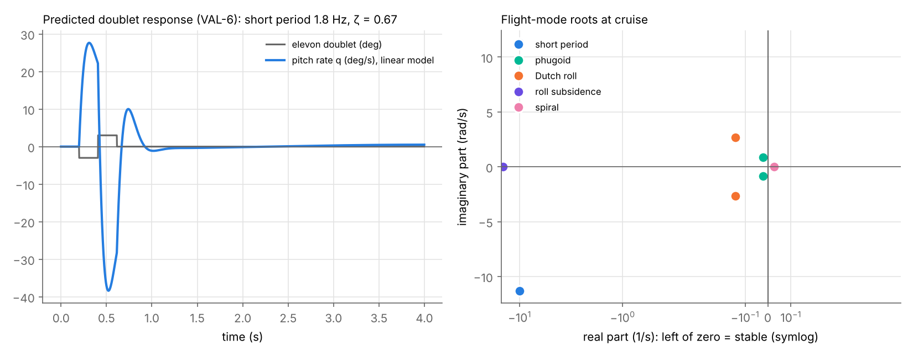
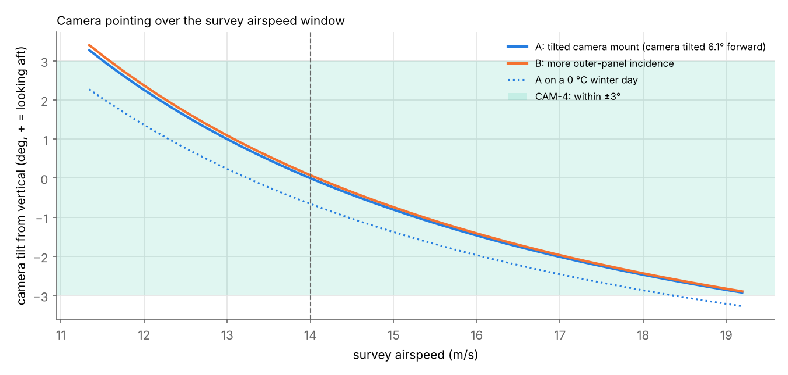

# Aerodynamics and stability (milestone M1.4)

## The short answer

The baseline from M1.3 (1.53 m span, 0.40 m², 25° sweep, 5° washout) behaves
the way a forgiving flying wing should:

| Question | Answer | Requirement |
|---|---|---|
| Where is the neutral point? | 290 mm behind the pod nose, 33.6 % MAC | — |
| Where may the CG go? | 261 to 275 mm from the pod nose (a 15 mm band) | AC-7, 5–10 % static margin |
| Does it trim hands-off at cruise? | Yes: elevons −1.4° to +2.2° across that band | AC-8, within ±3° ✔ |
| Stall speed (1.5 kg, field, 32 °C) | 8.7 m/s at the middle CG (8.6–8.9 across the band) | AC-1, ≤ 9 m/s ✔ |
| Where does the stall start? | Just outboard of the panel joint. The outer half of the elevons is still 15 % below its limit, and the pod is at 59 % | "centre stalls first" ✔ |
| Cruise drag | CD 0.023, L/D 16 at 14 m/s (probably optimistic, see below) | — |
| Pitch dynamics | Short period 1.8 Hz, damping ratio 0.67 (well damped) | VAL-6 prediction |
| Lateral | Stable, but the Dutch roll is lightly damped (ratio 0.05) | watch item |
| Camera (CAM-4) | **Tilt the camera mount 6° forward.** Don't add panel incidence | CAM-4 ✔ |

Everything comes from one command:

```bash
pip install -e ".[dev]"
python -m manta_mapper.stability config/mission.toml --plots docs/img --report docs/stability_report.txt
```

It takes about two and a half minutes on a laptop. It prints the full report
(saved in [stability_report.txt](stability_report.txt)) and draws the five
plots on this page. Nothing outside Python is needed. AeroSandbox and
NeuralFoil are installed by the `dev` extra.

## How it is worked out

Two cheap tools, each used for what it is good at (code in
`src/manta_mapper/aero.py`):

- **Vortex lattice (AeroSandbox VLM)** for anything that depends on the
  planform: lift slope, pitching moment, neutral point, how lift is spread
  along the span, induced drag, elevon power, and how the aircraft responds
  to pitch, roll, yaw and sideslip. It treats the wing as a thin, cambered,
  frictionless sheet.
- **NeuralFoil** (the airfoil tool from M1.2) for what the VLM can't see:
  skin-friction drag and where each slice of the wing stalls. Each spanwise
  strip gets the section it really has (MH 78, the blend, or S5010) at its own
  chord and Reynolds number, *as built* (1 mm blunt trailing edge, early
  transition, AC-15).

They are joined by strip theory: the VLM says what lift coefficient each strip
carries, and NeuralFoil says what that strip's drag is at that lift coefficient
and how much more it could carry before stalling.

Three things the VLM can't model, and how they are handled:

1. **Elevons.** AeroSandbox's VLM ignores control surfaces, so a deflection is
   modelled by bending the camber line of the sections it covers. Theory
   overstates how much a real flap does, so every deflection is multiplied by
   0.75. That is the cautious direction: it makes every trim deflection a bit
   bigger than it will really be.
2. **Stall.** The VLM's lift line never bends over. The wing's maximum lift is
   found by raising angle of attack (re-trimming the elevons at each step)
   until the first strip reaches its own section CL_max. That is the
   "critical section" method.
3. **Bits and pieces.** Skid, motor and prop hub, pitot, antennas, servo horns
   and the camera window are an itemised drag allowance (0.0021 of CD), plus
   15 % on the wing and fin profile drag for seams, hinge gaps and junctions.

**Why not AeroSandbox's faster AeroBuildup?** It was tried as a cross-check and
rejected for pitching moment. On a plain swept, tapered wing with a symmetric
section it puts the neutral point at 16–20 % MAC, where the VLM and textbook
values are about 24–26 % (`test_plain_swept_wing_neutral_point_is_textbook`
holds the VLM to that). The independent check of the VLM is VSPAERO in M1.7.

## 1. Neutral point and the CG range

The neutral point is the balance point for *changes* in lift: put the CG
there and the aircraft doesn't care which way it is pointing. Put it ahead
of the neutral point and any nose-up disturbance makes a nose-down moment
that corrects it. The distance between the two, as a fraction of the mean
chord (293 mm), is the static margin.

| Static margin | CG from the pod nose | CG in % MAC |
|---|---|---|
| 10 % (most stable) | 261 mm | 23.6 % |
| 7.5 % (design) | 268 mm | 26.1 % |
| 5 % (least stable allowed) | 275 mm | 28.6 % |

The neutral point sits further back than a plain wing's (about 25 % MAC)
because the pod carries less lift than its size suggests (see the spanwise
plot), so the lift centre moves out and back onto the swept panels.

**For the first glides, balance at the 10 % end (261 mm).** It costs a few
degrees more up-elevon at low speed (below), and buys margin against the one
number that could be badly wrong. Even if AeroBuildup's pessimistic neutral
point were right, a CG at 23.6 % MAC would still be stable.

## 2. Trim: does it fly hands-off?



Left: pitching moment about the CG against lift coefficient, with the elevons
neutral. All three lines slope down, so the aircraft is stable. They cross
zero (the trim point, where it flies by itself) near the cruise lift
coefficient. The reflexed sections plus washout give a nose-up moment at zero
lift (Cm0 = +0.03), which is what lets a tailless wing balance at all.

Right: the elevon needed to trim at each airspeed.

| Static margin | Stall | Hand launch (1.2 Vs) | Slowest survey | Cruise 14 m/s | Fastest survey |
|---|---|---|---|---|---|
| 5 % | −3.6° | −0.8° | +0.3° | **+2.2°** | +3.8° |
| 7.5 % | −7.8° | −3.7° | −2.4° | **+0.4°** | +2.9° |
| 10 % | −11.7° | −6.4° | −5.0° | **−1.4°** | +1.9° |

(+ = trailing edge down.) At cruise every CG in the band trims within ±3°
(AC-8). Even the worst case, stall at the forward CG, uses 12° of an assumed
20° throw, leaving 8° for roll. Elevon pitch power about the CG is −0.0065 Cm
per degree.

## 3. Lift, drag and the glide prediction



- **Lift slope** 0.074 per degree (4.2 per radian); zero lift at +1.1° on the
  pod chord line.
- **Cruise** (14 m/s, 100 m above the field, 32 °C): CL 0.38, CD 0.023, made
  up of induced 0.0078, wing profile 0.0111, fins 0.0005 and extras 0.0038.
  L/D 16.2, about 12.7 W of drag power before prop and motor losses.
- **Best L/D** 16.4 at 13.5 m/s; **minimum sink** 0.69 m/s at 9.5 m/s.

The induced drag uses a span efficiency computed from the VLM's own lift
distribution (e ≈ 0.97), ignoring any help from the drooped fins. The VLM's
own drag number is about 10 % lower; the cautious one is used.

**Treat L/D 16 as optimistic.** Small printed flying wings usually measure
L/D 10–14. Real-world losses this model can't see include prop wash over the
pod, leaky hatches, wavy printed skins and imperfect airfoils. The drag here is
still well below the 0.025 zero-lift drag the constraint analysis assumed, so
the battery sizing (which used 0.025 and then added 25 %) has plenty in hand.
The glides in M3.4 (VAL-1) will settle it; the lower-right plot is the
prediction those glides will be compared with.

The "clean" model (later transition) comes out with slightly *more* drag than
the as-built one. At these Reynolds numbers (150,000–350,000) early transition
shrinks the laminar separation bubbles, which can lower drag. The two curves
bracket that uncertainty.

## 4. Where does the stall start?



The dashed line is how much lift each slice of the wing *can* make. The orange
line is how much it *is* making when the first slice reaches its limit. The
gap between them is the margin.

- The first slice to stall is about 20–30 mm outboard of the panel joint,
  where the S5010 section meets the most loaded part of the wing.
- The outer half of the elevons is at 85 % of its limit (78 % at the 10 % CG,
  92 % at 5 %), and the tips fall off further still. So when the inner wing
  lets go, the nose drops and the elevons still bite. That gives a mushy,
  nose-down stall instead of a wing drop.
- The pod is at 59 % of its limit. It is nowhere near stalling.

The trimmed wing CL_max is 0.96 at the design CG (1.00 forward, 0.93 aft).
The geometry was sized on 0.95, so the 9 m/s stall requirement holds with a
little to spare. The up-elevon needed to trim near stall is what costs the aft
CG some lift.

This is a linear method with a stall check bolted on. Post-stall behaviour
(how sharp the break is, whether it rolls off) is beyond it. The glide tests
in M3.3 should approach the stall gently, at height.

## 5. Elevons, roll and lateral stability

- **Roll power**: 10° of differential elevon gives a steady roll rate of
  pb/2V = 0.09, about 70°/s at launch speed and 95°/s at cruise. That is
  plenty; 0.05 is a common minimum.
- **Adverse yaw** is tiny (Cn_δa = −0.00016 per degree).
- **Directional stability** (Cn_β = +0.0065 per radian) is positive but small,
  as expected for a tailless wing with 65 mm fins. The dynamic version, which
  also counts the help from the swept wing's roll stability, is +0.0135. Both
  must be positive, and are.
- **Roll stability** (Cl_β = −0.055 per radian) is solid. Sweep more than
  makes up for the drooped (anhedral) fins.

The VLM can't see the yaw damping from profile drag (the wing going faster
on one side drags more), so it is added from the strip drag: −0.0033, about
half of the total Cn_r.

## 6. Flight modes and the doublet prediction



The linear equations of motion, with the derivatives above and a placeholder
mass model (45 % of the mass spread over the wing, 7 % motor, 48 % battery and
electronics in the bay; the real build-up is M1.5):

| Mode | Prediction | Verdict |
|---|---|---|
| Short period (the quick pitch bob) | 1.8 Hz, damping ratio 0.67 | well damped |
| Phugoid (slow speed-height swap) | 7.3 s period, damping 0.02 | normal for a clean glider; TECS handles it |
| Dutch roll (yaw-roll wag) | 2.4 s period, damping 0.05 | **lightly damped, watch** |
| Roll subsidence | 0.07 s time constant | crisp |
| Spiral | slowly divergent, doubles in 27 s | fine (the autopilot holds wings level) |

The short-period numbers are the VAL-6 target. The left plot is what a 3°
elevon doublet should look like in the IMU pitch-rate log. The frequency
depends on the pitch inertia, which is still a guess: ±30 % on it moves the
frequency between 1.6 and 2.1 Hz, inside VAL-6's ±25 % band once the real
inertia replaces the guess. Across the CG band it runs 1.5 Hz (5 %) to
2.0 Hz (10 %).

**The Dutch roll is the one real watch item.** A damping ratio of 0.05 means
a sideways gust sets off a gentle wag that takes a few cycles to die out. It
is common on small tailless wings, it won't make the aircraft unstable, and
the VLM probably understates the damping (it misses fin and pod side force
from viscosity). But ArduPilot can't damp it without a rudder, and a
persistent wag could smear yaw across a photo line. A quick sensitivity run:

| Fins | Dutch roll damping | Spiral doubles in | Fin tip ground clearance |
|---|---|---|---|
| 65 mm, 45° droop (baseline) | 0.053 | 27 s | 23 mm |
| 90 mm, 45° droop | 0.080 | 14 s | 5 mm |
| 120 mm, 45° droop | 0.110 | 9 s | fins hit the ground |

Bigger fins fix it but eat the ground clearance and make the spiral mode less
stable. Recommendation: let the M1.6 optimizer carry "Dutch roll damping ≥
0.08" as a constraint, with fin size and skid depth free. It will probably
land on about 90 mm fins with a deeper skid. Until then the baseline stays as
it is.

## 7. Camera tilt (CAM-4): mount or panel incidence?

The pod flies 6.1° nose-up at cruise, so a camera fixed flat in the pod would
look 6° aft. CAM-4 allows 3°. Two ways to fix it were compared:



| | A: tilt the camera mount 6° forward | B: twist the outer panels up so the pod flies level |
|---|---|---|
| Geometry change | none | +11° panel incidence relative to the pod |
| Cruise elevon | +0.4° | **−10.6°** (fails AC-8) |
| Cruise drag | CD 0.0233 | CD 0.0283 (+21 %) |
| Stall speed | 8.7 m/s | **11.0 m/s** (fails AC-1) |
| Outer elevon margin at stall | 15 % | 48 % (tips now unloaded too far) |
| Camera within ±3° | 11.5 to 19 m/s | about the same |

**Recommendation: A, the tilted camera mount.** The surprise is how much
incidence B needs. The pod and blend make about 30 % of the lift at cruise, so to bring *it*
level the panels must take over almost all the lift at a lower pod angle,
which takes 11° of extra incidence, not 6°. That wrecks the trim (the pod is
ahead of the CG, so unloading it pitches the nose down), and the up-elevon
needed to fight that costs lift and stall speed. Tilting a 30 mm camera board
is free and can be adjusted later.

How to build it:

- Print the camera mount so the lens points 6° forward of the pod's vertical.
  Make the angle a printed wedge (4°, 6°, 8°) so it can be swapped after the
  first survey flight shows the real cruise pitch in the log (CAM-4 test).
- Fly surveys at a fixed airspeed (ArduPilot `AIRSPEED_CRUISE` = 14 m/s).
  Across 11.5–19 m/s the camera stays within ±3°, so a ±2 m/s change is fine.
  A cold day shifts it by under 1°.
- If the survey speed is ever changed a lot (say 12 or 17 m/s), swap the
  wedge.

## What this changes downstream

- **M1.5 weights**: put the CG at 261–275 mm from the pod nose; aim for 268 mm
  and use 261 mm for the first flights. Replace the placeholder inertia.
- **M1.6 optimizer**: constraints to carry: static margin 5–10 %, trim
  within ±3° at cruise, stall ≤ 9 m/s via the critical-section method with
  trim, outer-elevon stall margin ≥ 10 %, Dutch roll damping ≥ 0.08. One
  evaluation at one CG (model, trim, cruise drag, stall) takes 15–40 s: fine
  for a coarse search, and the stall step is the one to speed up if needed.
- **M1.7 VSPAERO**: compare neutral point, lift slope and cruise drag (PIPE-4).
- **M2.3 CAD**: camera mount with a 6° forward tilt on a swappable wedge.
- **Flight tests**: VAL-1 sink-rate curve and VAL-6 doublet shape above; VAL-5
  trim elevon +0.4° at cruise at the design CG.

## Limits

- Inviscid, thin-surface VLM: no pod thickness effects, no prop wash.
- The stall is the first strip reaching its limit, not a post-stall model.
- The 0.75 elevon effectiveness factor and the drag allowances are judgement
  calls; each is a named constant at the top of `aero.py`.
- Masses and inertias are placeholders until M1.5.
- One airspeed for the derivatives (cruise). Modes at launch speed come once
  the inertia is real.
