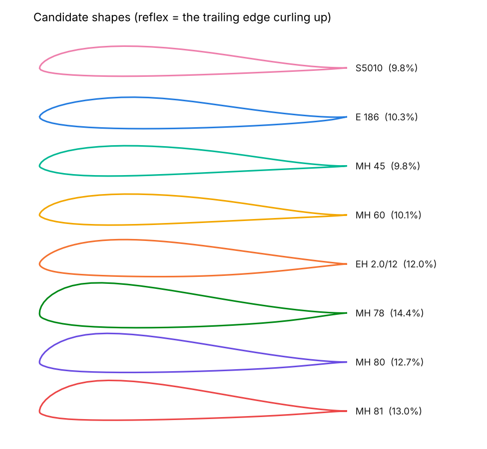
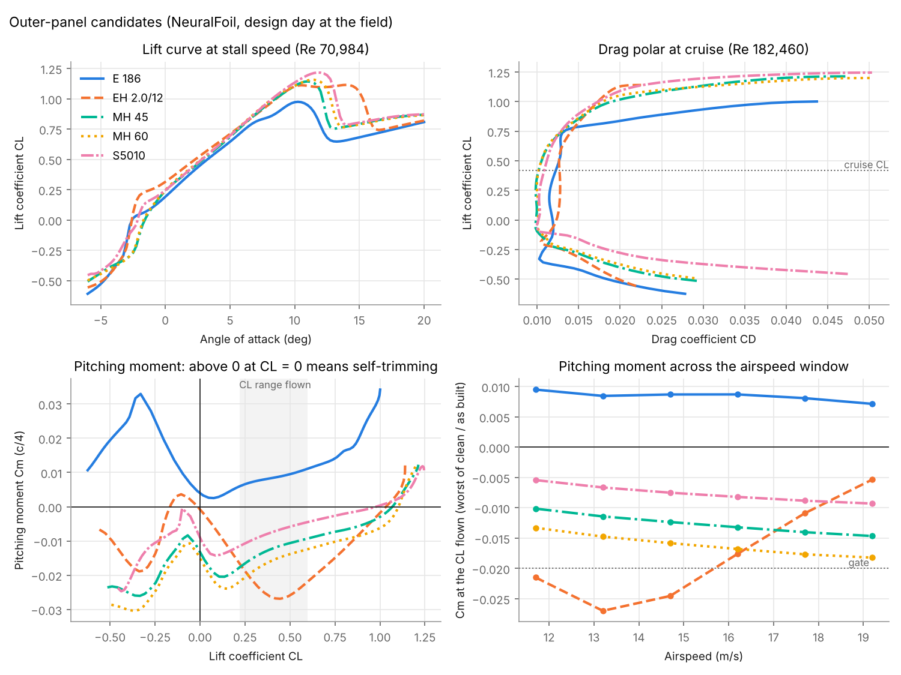
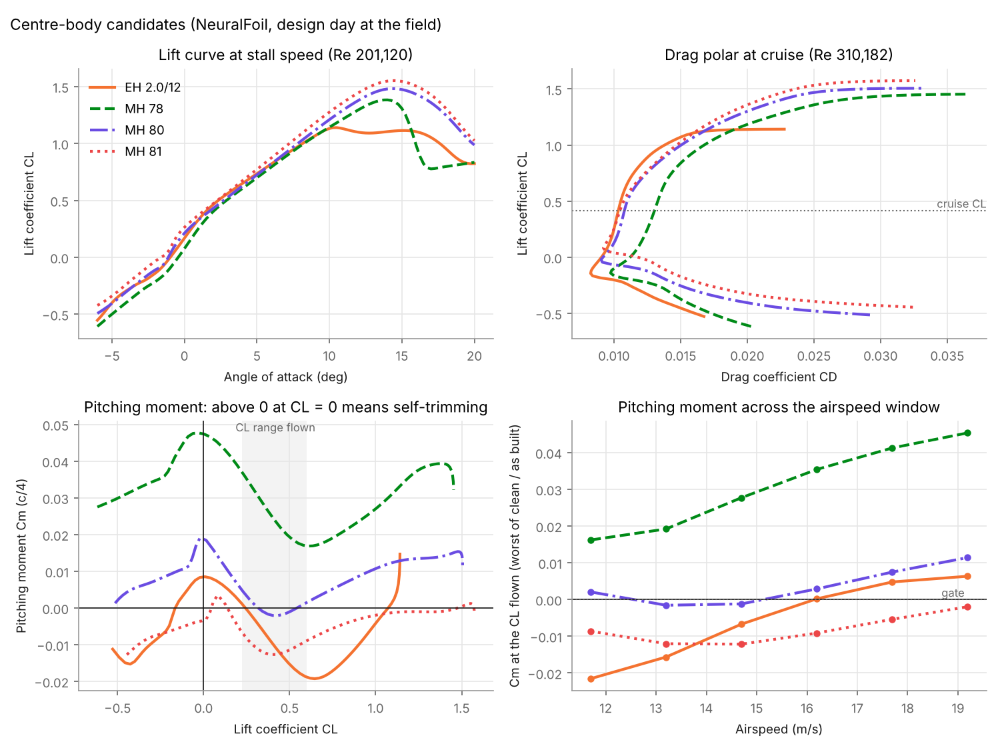
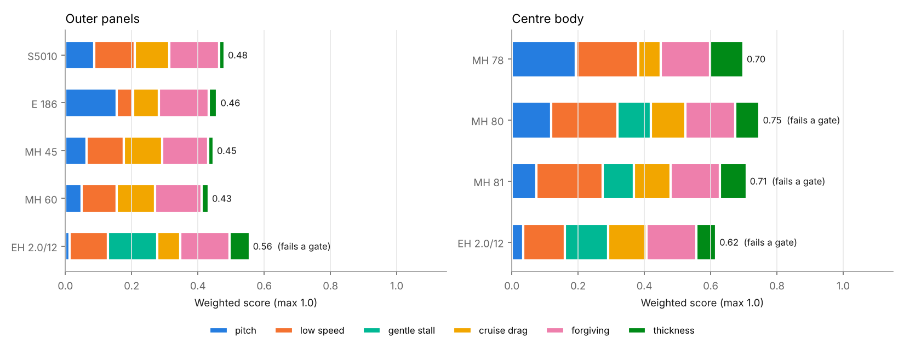

# Airfoil selection (milestone M1.2)

## The short answer

- Outer panels: **S5010** (Selig, 9.8 % thick)
- Centre body: **MH 78** (Hepperle, 14.4 % thick)

Runner-up for the outer panels is MH 45, close behind. Both choices come from
`python -m manta_mapper.airfoils config/mission.toml`, which re-runs the whole
comparison from the mission file in about three seconds.

The rest of this page explains how the choice was made, in the order the code
does it.

## 1. Why a flying wing needs a special airfoil

Every cambered airfoil makes lift and also a nose-down twisting moment, the
**pitching moment** `Cm`. On a normal airplane the tail pushes down a little to
cancel it. A flying wing has no tail, so the wing has to balance itself.

The trick is **reflex**: the back of the airfoil curls slightly upward, like a
small, permanently raised elevon. That cancels the nose-down moment, so the
section's `Cm` sits near zero or nose-up (positive).

How much nose-up moment does the whole wing need? For the wing to trim with
its centre of gravity *ahead* of the neutral point (which is what makes it
stable), it needs roughly

```
Cm_wing ≈ CL × static margin = 0.42 × (0.05 to 0.10) ≈ +0.02 to +0.04
```

at cruise. That moment comes from three places: the airfoil, the sweep of the
outer panels combined with **washout** (tips twisted a few degrees nose-down),
and as a last resort a little up-elevon. Up-elevon costs lift and drag, so the
goal is for airfoil plus washout to do the job (AC-8: trim within ±3°
elevon).

The cost of reflex is lift. Curling the trailing edge up takes away some of
the camber that makes lift, so reflexed airfoils have a lower maximum lift
coefficient `CL_max`. A lower `CL_max` means a higher stall speed, and hand
launch needs a stall at or below 9 m/s (AC-1). That is the central trade.

## 2. Where this wing actually flies

Airfoil data in textbooks is usually for big aircraft at Reynolds numbers in
the millions. Small, slow wings live at 50,000 to 500,000, where air flowing
over the wing can separate and re-attach in a "laminar separation bubble".
This changes drag, `CL_max` and, importantly for us, the pitching moment. So
the comparison runs each airfoil at the Reynolds numbers it will really see:
on the design day (32 °C at the 1220 m field), at the stall speed and across
the 11.7-19.2 m/s airspeed window from the constraint analysis.

| Condition | Airspeed (m/s) | Chord (mm) | CL needed | Reynolds number |
|---|---|---|---|---|
| Stall, tip chord, at the field | 9.0 | 148 | CL_max | 70,984 |
| Stall, centre body | 9.0 | 419 | CL_max | 201,120 |
| Slowest survey speed, mean chord | 11.7 | 246 | 0.60 | 152,485 |
| Cruise, mean chord | 14.0 | 246 | 0.42 | 182,460 |
| Cruise, centre body | 14.0 | 419 | 0.42 | 310,182 |
| Fastest survey speed, centre body | 19.2 | 419 | 0.22 | 425,216 |

The chords are placeholders until the parametric geometry exists (M1.3):
centre body 1.7× and tip 0.6× the 246 mm mean chord from sizing. The tip at
stall is the hardest case, at only about 71,000.

## 3. The candidates



Outer panels (thin, swept, foam): MH 45, MH 60, E 186, S5010 and EH 2.0/12.
These are well-known flying-wing sections. Centre body (deep, for the battery,
Pi and camera): EH 2.0/12, MH 80, MH 81 and MH 78. EH 2.0/12 is in both lists
because using one family across the span would simplify the build.

## 4. How each airfoil is judged

Each candidate runs through **NeuralFoil**, a neural network trained on
millions of XFOIL runs. It gives the same answers as XFOIL to within XFOIL's
own scatter, never fails to converge, and is fast enough to go inside the
optimizer later. Each airfoil is analysed twice:

- **Clean**: the exact coordinates, smooth surface.
- **As built**: a 1 mm thick trailing edge (hot-wire foam or a print can't
  make a knife edge) and early boundary-layer transition (`n_crit` 5 instead
  of 9) to stand in for tape seams, film wrinkles, dust and gusty desert air.
  This is AC-15, and it is how "forgiving to build" gets a number.

### Gates (pass/fail)

| Gate | Outer panels | Centre body | Why |
|---|---|---|---|
| Section depth | ≥ 12 mm at 25 % of the tip chord | ≥ 46 mm at the deepest point | a 10 mm carbon spar with 1 mm of material each side; ~40 mm of payload plus 3 mm walls |
| Worst `Cm` across the airspeed window, clean *or* as built | ≥ −0.02 | ≥ 0 | the swept outer panels can get the rest from washout; the big, unswept centre body must not fight the trim |
| NeuralFoil confidence over the flown CL range | ≥ 0.7 | ≥ 0.7 | below this the network is guessing |

Note that the pitch gate uses the moment **at the lift coefficient actually
flown** at each speed, not only the textbook `Cm0` at zero lift. At these low
Reynolds numbers `Cm` wanders with `CL` (see the moment plots below), and
EH 2.0/12 shows why this matters: a near-zero `Cm0` but −0.027 at cruise.

### Scores (for the airfoils that pass)

Each metric goes onto a fixed 0-to-1 scale (so adding a candidate never
changes another one's score), then gets a weight. The weights favour robust
and forgiving over squeezing out drag:

| Score | Weight | 0 point | 1 point |
|---|---|---|---|
| Pitch: worst `Cm` in the window | 25 % | −0.03 | +0.03 |
| Low speed: `CL_max` as built, at the stall Reynolds number | 20 % | 0.8 | 1.4 |
| Gentle stall: lift kept 3° past the stall ÷ `CL_max` | 15 % | 0.70 | 1.00 |
| Cruise drag: mean section `CD` across the window | 15 % | 0.016 | 0.008 |
| Forgiving: drag change when built imperfectly | 15 % | +30 % | 0 % |
| Thickness | 10 % | 9 % | 14 % |

## 5. Results

### Outer panels

| Rank | Airfoil | t/c | Spar depth at tip (mm) | Cm0 | Worst Cm in window | CL_max clean / built | Stall retention (confidence) | Mean CD in window | Cruise L/D | CD change as built | Gates | Score |
|---|---|---|---|---|---|---|---|---|---|---|---|---|
| 1 | S5010 | 9.8% | 14 | −0.009 | −0.009 | 1.22 / 1.17 | 0.66 (0.55) | 0.0104 | 38 | 0% | pass | 0.48 |
| 2 | E 186 | 10.3% | 15 | +0.004 | +0.007 | 0.97 / 0.95 | 0.66 (0.35) | 0.0118 | 34 | −3% | pass | 0.46 |
| 3 | MH 45 | 9.8% | 14 | −0.013 | −0.015 | 1.14 / 1.14 | 0.67 (0.52) | 0.0098 | 41 | +2% | pass | 0.45 |
| 4 | MH 60 | 10.1% | 15 | −0.015 | −0.018 | 1.16 / 1.12 | 0.67 (0.49) | 0.0098 | 41 | +2% | pass | 0.43 |
| 5 | EH 2.0/12 | 12.0% | 18 | −0.001 | −0.027 | 1.11 / 1.15 | 1.00 (0.95) | 0.0123 | 33 | −6% | fails pitch gate | 0.56 |



### Centre body

| Rank | Airfoil | t/c | Max depth (mm) | Cm0 | Worst Cm in window | CL_max clean / built | Stall retention (confidence) | Mean CD in window | Cruise L/D | CD change as built | Gates | Score |
|---|---|---|---|---|---|---|---|---|---|---|---|---|
| 1 | MH 78 | 14.4% | 60 | +0.047 | +0.016 | 1.38 / 1.37 | 0.56 (0.41) | 0.0124 | 32 | −9% | pass | 0.70 |
| 2 | MH 80 | 12.7% | 53 | +0.019 | −0.002 | 1.48 / 1.47 | 0.90 (0.86) | 0.0104 | 39 | −5% | fails pitch gate (just) | 0.75 |
| 3 | MH 81 | 13.0% | 54 | −0.003 | −0.012 | 1.55 / 1.53 | 0.89 (0.83) | 0.0101 | 40 | −4% | fails pitch gate | 0.71 |
| 4 | EH 2.0/12 | 12.0% | 50 | +0.008 | −0.022 | 1.14 / 1.17 | 0.96 (0.97) | 0.0098 | 40 | −5% | fails pitch gate | 0.62 |





### Does the answer depend on the weights?

The code re-ranks the passing airfoils under four other weightings (equal,
pitch-heavy, lift-heavy, drag-heavy). S5010 wins the outer panels under four
of the five, and E 186 wins only when pitch is weighted at 40 %. MH 78 wins
the centre body under all five, because it is the only centre candidate that
passes the pitch gate. So the choice does not hinge on the exact weights.

## 6. Why these two, and what we gave up

**S5010 for the outer panels.** It is the best all-rounder: the highest
`CL_max` of the passing candidates (1.17 as built at the tip's 71,000 Reynolds
number, which is what sets the stall speed), low drag, a pitching moment only
slightly nose-down (−0.009, easy to cover with washout), and it hardly
changes when built roughly. It was designed for small flying wings at low
Reynolds numbers, which is exactly where this one lives. At 9.8 % it is thin,
but the tip still has 14 mm of depth at the spar line, enough for a 10 mm tube.

- **MH 45** (runner-up) has a little less drag and a long record on flying
  wings, but a more nose-down moment (−0.015 against −0.009), so it needs a
  bit more washout, and slightly less `CL_max`. It is a good fallback if
  S5010 disappoints in the VLM.
- **E 186** is the most self-trimming (positive `Cm` everywhere), but its
  `CL_max` of 0.95 would push the stall speed up. Keeping 9 m/s would then
  need about 20 % more wing area: a bigger, heavier aircraft to buy margin we
  can get more cheaply from washout.
- **EH 2.0/12** scored highest on paper (thick, the gentlest stall) but its
  moment at cruise (−0.027) fails the pitch gate. It would need a lot of
  washout or permanent up-elevon. That is the reason the gates exist: a high
  score should not hide a property that the aircraft can't live without.

**MH 78 for the centre body.** It is the only centre candidate that stays
nose-up across the whole airspeed window, clean and as built, so the deep
centre body actively helps the trim instead of fighting it. At 14.4 % it
gives 60 mm of depth for the battery, Pi and camera, and its `CL_max` (1.37)
is well above the outer panels'. The price is about 20 % more section drag
than MH 80 and a sharper stall in NeuralFoil's estimate (which is least
reliable exactly there). MH 80 missed the gate by only 0.002; if the VLM shows
the whole wing has trim to spare, it is the first swap to consider.

## 7. What this changes downstream

1. **Wing `CL_max`.** A rough rule (90 % of the section value for a swept,
   tapered wing, then another 10 % lost to trimming with up-elevon) gives
   about 0.95 from the S5010's 1.17. The constraint analysis assumed 1.0.
   That is about 5 % more wing area for the same 9 m/s stall. M1.4 (VLM)
   replaces both numbers with a computed one.
2. **The tips must not stall first.** The outer section's `CL_max` (1.17 at
   the tip) is lower than the centre body's (1.37), and swept wings load
   their tips. Left alone, the tips could stall first and drop a wing on
   launch. The geometry (M1.3) therefore needs washout, and the VLM (M1.4)
   must check local `CL` against local `CL_max` along the span, so the
   centre stalls first and the nose drops gently. Washout is also what
   supplies the extra nose-up trim, so one feature does both jobs.
3. **Blend.** The centre body blends from MH 78 to S5010 across the
   transition to the outer panels. The outer panels can be one constant
   section, tapered, which is exactly what a hot-wire cutter with root and
   tip templates does well.

## 8. Limits of this step

- 2-D only. Sweep, taper, the centre-body blend and the winglets come in
  with the VLM (M1.4) and VSPAERO (M1.7).
- Post-stall numbers (stall retention, the sharpness of the break) are the
  least reliable part of NeuralFoil; the confidence in brackets says so. Use
  them to compare, not to predict.
- XFOIL was not run as a cross-check here (NeuralFoil is trained on it). If
  wanted, `asb.XFoil` can re-run the two chosen sections in a few lines.
- The chords are placeholders, so the Reynolds numbers will move a little
  once the planform exists. The test `test_documented_choice_matches_pipeline`
  fails if that ever changes the answer, so this page gets revisited.

## Re-running

```bash
pip install -e ".[dev]"   # includes AeroSandbox + NeuralFoil
python -m manta_mapper.airfoils config/mission.toml --plots docs/img
```

Candidates, gates, scales and weights are all at the top of
`src/manta_mapper/airfoils.py`, each with a comment saying why.
