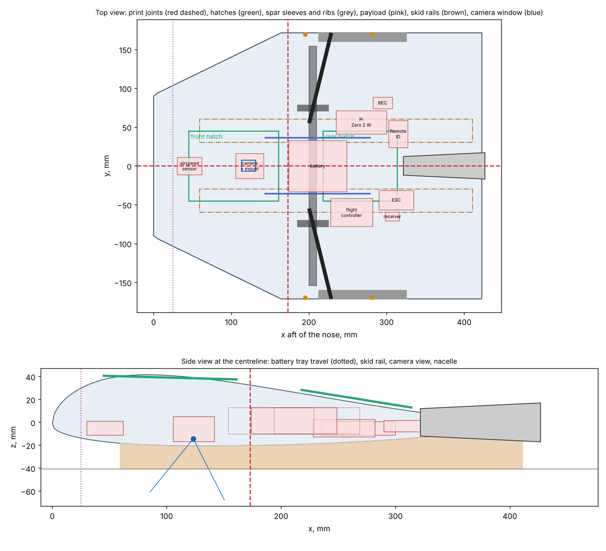
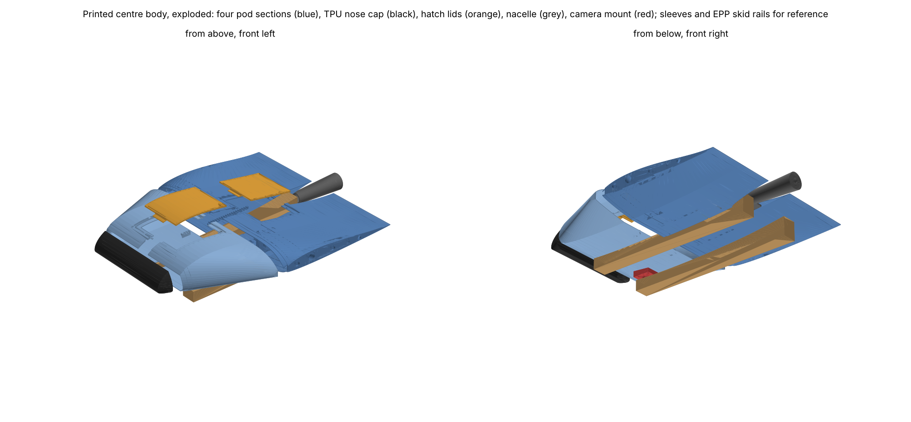

# Scripted CAD (milestone M2.3)

The CAD is generated from the pipeline geometry, the same way as everything
else here. `cad.py` does the design work in plain Python: where the pod
splits, where the spar sleeves, hatches, battery tray, camera and motor go,
how the payload packs, and whether it all fits. It writes the result out as a
**recipe** (`cad/manta_cad.json`): named solids built from nine primitive
operations, plus a list of parts. Two thin interpreters turn that recipe into
geometry:

- **Fusion 360** (`cad/fusion/MantaMapperCAD/`): editable bodies, one
  component per part, and STL export. This is the CAD of record.
- **manifold3d** (`cad_mesh.py`, plain Python): the same parts as meshes. The
  tests use it to prove every part is one closed solid that fits the printer,
  and it gives volumes and masses. Its STLs are committed in `cad/stl/` so
  you can slice them without opening Fusion.

```bash
pip install -e ".[dev]"     # includes manifold3d
python -m manta_mapper.cad --json cad/manta_cad.json --dxf cad/templates --stl cad/stl \
    --render docs/img/cad_parts.png --report docs/cad_report.txt --plots docs/img
```

Full numbers: [cad_report.txt](cad_report.txt).

## The answer

| | |
|---|---|
| **Print split** | Centreline + one chordwise cut at x = 173 mm, plus a 25 mm TPU nose cap. Four LW-ASA half-sections, the biggest 258 x 179 x 53 mm: 22 mm spare inside the K2 Pro's 300 mm bed after a 10 mm margin all round. The cut is chosen automatically. It is the fewest cuts that fit, placed clear of every rib, sleeve, strip, the camera and the nacelle |
| **Joints** | Each joint has a 1.6 mm spigot band inside the skin that reaches 8 mm into the next piece (0.1 mm glue gap). The aft piece carries the chordwise spigot, and the right half carries the centreline one. Epoxy |
| **Spar joint (M2.2)** | 14x12 sleeve, 120 mm, epoxied into two printed ribs with 15 mm bosses: the root rib at the panel face and a short (40 mm) inner rib at the spar's end, (205, ±74) mm, where `structures.py` put it. 10x1 mm carbon strips in the floor and roof at x = 205 mm, 309 mm long, on 1.2 mm skin lands and slotted through the ribs |
| **Panel catch** | Two 10x3 mm N52 magnets per side in the root face, plus the 3 mm anti-rotation pin at 60 % chord. That holds well over the 19 N M2.2 asks for, and it lets go cleanly in a cartwheel. Pull-test it at M2.4 |
| **Hatches** | Front, x 45-161 mm (battery and GPS on the lid), and rear, x 218-314 mm (electronics). Both are clear of the roof strip and the cut. Each lid has a locating lip and rests on a ledge. A hook goes under the front rim, so airflow can't peel the lid, and there are two 6x2 mm magnets at the back |
| **Battery tray** | Two rails with stop slots every 5 mm, and two printed end stops that key in and are held down by the strap (the 50 N fore-aft launch load from M2.2). Pack centre 191-231 mm, nominal 211 mm for the CG target |
| **Camera** | On the centreline at x = 124 mm, on a printed wedge tilted 6° forward (M1.4). The lens sits 6 mm above the outer skin, so belly landings never touch it. The window is 18 x 14 mm |
| **Motor** | Separate solid-ASA nacelle (24 → 34 mm cone, 4 mm firewall with the X2216 16/19 mm M3 pattern). Its tongue is bolted through the pod floor with three M3 bolts. Thrust seats it, and a prop strike breaks a cheap part, not the pod |
| **Skid** | **Two** EPP rails (30 mm wide, inner edges 30 mm off the centreline) with HDPE wear strips, on velcro. One centre skid would cover the camera window. Rails stay out of the camera's view by 14 mm |
| **Tip fins** | EPP, hot-wired, two 3 mm carbon pegs and tape (~30 N to pull off, per M2.2) |
| **EPP templates** | DXF and printable 3 mm PETG hot-wire templates for the panel root and tip (drawn round the spar hole, so a straight rod lines them up) and the fin root and tip; a panel plan view (elevon, servo pocket, lead channel, spar steps); the skid rail profile |
| **All checks** | 23 of 23 pass (printer fit, cut clearances, spar cover, bosses inside the skin, magnets, hatch sizes and strip clearance, battery and payload clearances, camera recess and view, fin and folded-prop ground clearance, no payload clashes) |





## Running it in Fusion 360

1. `python -m manta_mapper.cad --json cad/manta_cad.json` (the committed file
   is current for the merged design; rerun it after any geometry change).
2. In Fusion: **Utilities > Add-Ins > Scripts and Add-Ins**, then **+** next
   to My Scripts, pick `cad/fusion/MantaMapperCAD`, then **Run**. No repo
   checkout? Copy `cad/manta_cad.json` into the `MantaMapperCAD` folder: the
   script uses a recipe sitting next to it first, and writes the STLs beside it.
3. It opens a new design, builds the 18 parts (one component each; the
   left-hand panel, fin, sleeve and skid rail are mirrored copies of the right),
   and offers to export the printed parts as STL to `cad/stl_fusion/`.

The script is about 250 lines and only interprets the recipe. It uses
Fusion's loft for the airfoil bodies and the TemporaryBRepManager for boxes,
cylinders, transforms and booleans. **It has not been run in Fusion yet**:
Fusion isn't available in the cloud. Its first run is a laptop job. If an
operation fails, it carries on and lists the problems at the end. Meanwhile,
the committed STLs come from the same recipe.

## How the layout is decided

**Split.** The half-pod is 171 mm across to the panel root face, so a
centreline split is unavoidable on a 300 mm printer. It also keeps each
sleeve, with both of its ribs, in one piece, and the carbon strips bridge
the centreline joint. Chordwise, the code searches for the fewest cuts that
make every piece fit, with each cut 12 mm clear of the keep-outs: ribs,
sleeves and bosses, strip lands, camera mount, nacelle tongue, nose joint.
Among the legal cuts it picks the one with the most spare room. Between the
nose joint and x ≈ 173 mm is the only legal place. A printer much smaller
than the K2 Pro can't print the rear section without cutting through a rib,
and the code says so instead of quietly doing it.

**Spar line.** `structures.py` sized the tube by section depth. The CAD
places it on the line through mid-depth at 25 % chord at root and tip, not
on the chord line, because the S5010 is cambered. On the chord line the 12 mm
root tube would poke out of the bottom skin. The worst cover over the stepped
tube is 2.2 mm, at the tip (M2.2 asks for 2 mm).

**Payload packing.** M1.5 placed the payload by hand, and drawn properly it
didn't fit. The camera sat under the battery, and the flight controller and
Pi overlapped the tray rails and the sleeves. The CAD now packs it
automatically. Biggest item first, each item goes to the free spot nearest
its M1.5 position. That spot must be on the floor, clear of the roof by 2 mm,
and clear of every rib, sleeve, rail, the nacelle tongue and the items already
placed, also by 2 mm. Items may turn 90°. The battery then slides to put the
CG back on 261 mm, and the packing repeats until it settles. The result:

- the camera moves 109 mm forward to x = 124 mm, under the front hatch, ahead
  of the battery tray. The pack goes in over it, with 10.7 mm to spare;
- everything else stays within about 25 mm of its M1.5 spot. The flight
  controller, Pi, ESC, Remote ID, BEC and receiver sit either side of the
  tray and under the rear hatch;
- the battery's nominal centre moves from 205 mm to 211 mm.

**Durability choices** (20 belly landings, only skid and tips replaced):

- The twin EPP rails take every landing. The pod floor never touches the
  ground, and the lens sits 6 mm up inside its window.
- The fins sit 26 mm off the ground and release at ~30 N, so a tip strike
  costs a fin, not a spar (M2.2 sized the spar for exactly this).
- The nose cap is TPU and pushes on: a nose-in is a 20 g reprint.
- The nacelle is a separate bolted part, so a prop strike costs 35 g of ASA.
- The panels pop off their magnets in a cartwheel instead of breaking the
  sleeve.
- The folded prop clears the ground until 7° nose-up while sitting on the
  rails' aft end.

## What changed against earlier assumptions

| | Before | Now | Effect |
|---|---|---|---|
| Printed-part mass | 277 g (M1.5: pod 243 g incl. 60 % frames, nose cap 16, motor plate 10, camera mount 8) | 344 g from the CAD volumes (pod sections 245, lids 16, nose cap 20, nacelle 35, camera mount 7, end stops 10) | **+67 g**. About 1295 g as built with the 20 % structure allowance, 86 % of the 1.5 kg design mass. Every aero check was run at 1.5 kg, so they all still hold, but this is just over the optimizer's 85 % build-mass margin (1275 g). The battery slides 15 mm aft to hold the CG, still inside the tray's ±20 mm. The M2.4 weigh-in settles the real number |
| Skid | one 60 mm skid on the centreline | two 30 mm rails at ±30-60 mm | same mass. Camera view clear; more roll stability on the ground |
| Motor mount | 10 g plate in the pod TE | 35 g bolted ASA nacelle | heavier, but replaceable and it carries the motor properly |
| Panel catch | "nylon panel bolts" | magnets + pin | releases on its own in a cartwheel |
| Camera | x = 233 mm | x = 124 mm | was under the battery; CG held by the battery (+6 mm) |

The heaviest printed items are the 0.8 mm skin itself (~175 g of the 245 g of
pod), the ribs and the hatch rims. If the weigh-in comes in high, the first
levers are a 0.6 mm skin on the low-load front sections, lightening holes in
the root ribs, and printing the nacelle's cone in LW-ASA with a solid firewall.

## Things to check before or during the test prints (M2.4)

- **First Fusion run** on the laptop: compare the built parts' volumes with
  `cad_report.txt`.
- **Camera Module 3 hole pattern** (21 x 12.5 mm, M2) and the lens offset on
  the wedge. Check them against the board before printing the mount.
- **Pitot tube**: the airspeed sensor sits at x = 46 mm behind the nose cap.
  Where the tube exits (through the cap, or out to a panel leading edge) is
  still open.
- **Joint fit**: print the chordwise joint first (a short slice of each side)
  and check the 0.1 mm glue gap on your LW-ASA settings. The same goes for the
  sleeve bore (+0.15 mm) and the magnet pockets.
- **Fin tape pull test** (M2.2's 30 N) and the **panel magnet pull**
  (≥ 19 N to hold, well under what breaks the sleeve).
- **Hot-wire kerf**: the templates assume a 1 mm kerf. Cut a test piece and
  change `hotwire_kerf_mm` if it's different.
- Print orientation: pod sections cut-face down with tree supports under the
  roof; lids outside up; nacelle firewall down.

## Files

| Path | What |
|---|---|
| `src/manta_mapper/cad.py` | layout, packing, cut search, checks, recipe, report, CLI |
| `src/manta_mapper/cad_mesh.py` | manifold3d interpreter, STL export, part stats, render |
| `src/manta_mapper/cad_templates.py` | DXF writer and the EPP templates |
| `cad/fusion/MantaMapperCAD/` | the Fusion 360 script |
| `cad/manta_cad.json` | recipe + layout for the merged design |
| `cad/stl/` | printed parts (from manifold3d) |
| `cad/templates/` | DXF templates, 1:1 mm |
