# CFD check of the 1.84 m design (milestone M2.1)

The top rung of the fidelity ladder: NeuralFoil → AeroSandbox VLM → VSPAERO →
**RANS CFD**. This is the first analysis that sees the real thick pod, the
blend, the fin junction and viscous flow. VSPAERO's panel mode could not mesh
the fin joint, so until now nothing had looked at thickness effects.

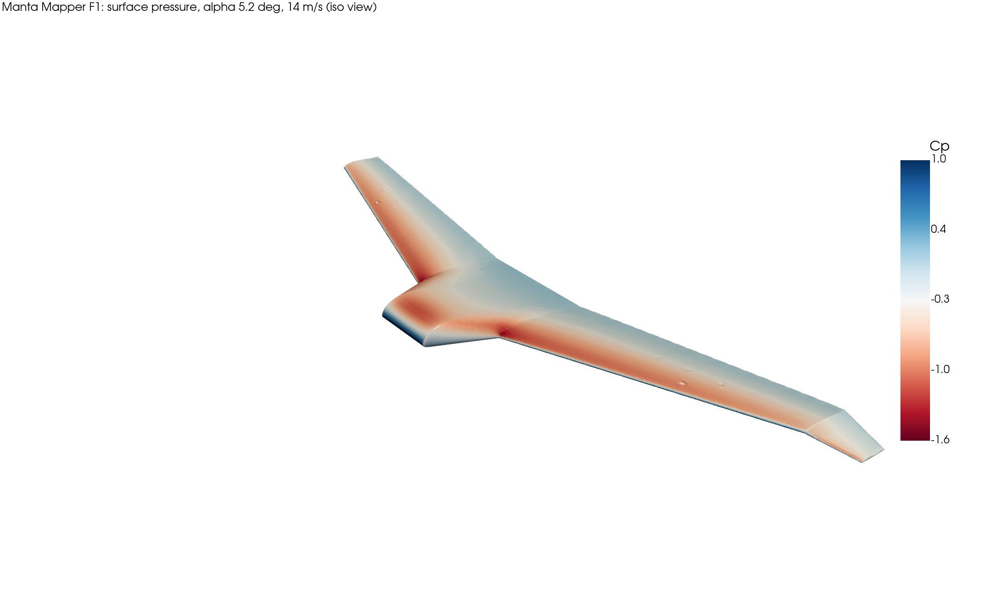

## The short answer

| Question | Answer |
|---|---|
| Where is the neutral point? | **279 mm from the pod nose (34.8 % MAC).** That falls between AeroSandbox (281 mm) and VSPAERO (273 mm), much closer to AeroSandbox. At the planned 260.5 mm CG the static margin is **7.1 %** (pipeline 8.1 %, VSPAERO 5.0 %). The 8 mm forward CG shift recommended after VSPAERO is not needed for stability. Keeping the 252 mm first-flight CG still costs nothing and adds margin |
| Lift slope? | 4.47 /rad: 7 % below AeroSandbox and 4 % below VSPAERO (PIPE-4 limit 10 %) ✔ |
| Trim at cruise? | Cruise CL 0.362 at **alpha 4.9°**, the same in all three codes. Cm at the CG is +0.006 with the elevons neutral, a small nose-up moment: a fraction of a degree of down-elevon |
| Spanwise loading? | Lies on top of VSPAERO's from the blend to the tip. The pod carries slightly less, because the thick pod and real blend are not a flat VLM sheet |
| Where does the stall start? | **Just outboard of the panel joint, inboard of the elevons**: reversed flow appears there first (5° to 8°) and spreads outboard. This confirms the M1.4 "inboard first" result, now with thickness and the real junction modelled |
| How high does CL go? | Only **0.74 (at 14°)** in this CFD, against the 0.93 trimmed the stall-speed sizing assumed. **This is the turbulence model, not the wing.** The same solver on the S5010 airfoil alone stalls at cl ≈ 0.76, where NeuralFoil gives 1.2 (section 5). The 3-D RANS cannot settle CL_max here; the 8.7 m/s stall speed still rests on NeuralFoil until flight test |
| Drag? | **CD 0.028 at cruise, L/D 12.8**, against 0.021 (pipeline) and 0.023 (VSPAERO). The CFD is fully turbulent, so this is an upper bound: at Re 1.9 × 10⁵ the real wing runs laminar over much of its chord. Even at L/D 12.8 the 25 ha mission closes (M1.5 holds with L/D down to 10) |
| Fin junction? | Clean. No separation at the joint at cruise, and the tip vortex sits at the fin tip (section 4) |

## 1. How it was run

* **Geometry.** `cfd.surface` lofts a watertight full-span surface straight
  from `BWBGeometry`: the same stations, airfoils (MH 78 pod, S5010 panels,
  NACA 0009 fins), chords, washout, dihedral and fin droop as the VLM. The
  surfaces between stations are ruled, which is exactly what a hot-wire cut
  gives. The fin is part of the same loft, so the junction is closed by
  construction (this is what broke OpenVSP's panel mesh). The sections morph
  from S5010 to NACA 0009 over the first 25 % of the fin, and the fin twist
  blends from the tip washout to zero. Trailing edges get 0.8 mm minimum
  thickness, about what the build will have.
* **Mesh.** snappyHexMesh, half model with a symmetry plane, prism layers on
  the aircraft (first cell 0.5 mm). Domain about 25 pod chords upstream and
  sideways and 45 downstream.
* **Solver.** OpenFOAM v2406 `simpleFoam` (steady, incompressible; Mach 0.04),
  k-ω SST, Spalding wall function (valid at any y+), fully turbulent.
  Free stream 14 m/s, ρ 0.989 kg/m³, Re 1.93 × 10⁵ on the MAC: exactly the
  VSPAERO case. Moments are taken about x = 260.5 mm (the pipeline's SM 7.5 %
  CG). Elevons neutral, no propeller, no skid.
* **Post.** Forces are read raw (total force and moment about the CG) and
  converted to coefficients in Python, so no OpenFOAM convention has to be
  trusted. Integrating the exported surface pressure and wall shear gives the
  same CL and CD to 0.1 %, which checks the post-processing.

```bash
python -m manta_mapper.cfd case config/mission.toml --out cfd/runs --alpha 5.2 --mesh medium
cfd/run_case.sh cfd/runs/F1_medium_ap05_2            # OpenFOAM in Docker, or <case>/Allrun natively
python -m manta_mapper.cfd case config/mission.toml --out cfd/runs --alpha 0 2.5 8 \
    --mesh medium --iterations 500 --mesh-from cfd/runs/F1_medium_ap05_2   # reuse the mesh
python -m manta_mapper.cfd analyse config/mission.toml --report docs/cfd_report.txt \
    --json docs/cfd_result.json --plots docs/img/cfd --archive cfd/results --sec cfd/sec
```

Meshes and fields stay out of git (`cfd/runs/`, a few hundred MB per case).
The force histories, mesh statistics and case settings of every run are kept in
[`cfd/results/`](../cfd/results), so the report and plots can be regenerated
without OpenFOAM (`analyse --runs cfd/results --no-renders`). The full numbers
are in [cfd_report.txt](cfd_report.txt).

**Where it ran.** Ubuntu 24.04's packaged OpenFOAM (v1912) can mesh, but
crashes on any function object, so it cannot record forces. The cloud runs use
the official `opencfd/openfoam-run:2406` Docker image. Ethan's laptop now has
OpenFOAM v2406 under WSL2, and the fine-mesh case ran there in parallel with
the cloud sweep.

## 2. Mesh convergence

All at the cruise angle (5.2°). The fine mesh ran on Ethan's laptop (8 cores,
3 h 31 min); the other two ran in the cloud.

| Mesh | Cells | CL | CD | CD friction | Cm at CG |
|---|---|---|---|---|---|
| coarse | 0.38 M | 0.396 | 0.0325 | 0.0120 | −0.001 |
| medium (used for the sweep) | 1.45 M | 0.385 | 0.0290 | 0.0131 | +0.004 |
| fine | 4.69 M | 0.415 | 0.0294 | 0.0143 | −0.005 |

Drag is mesh-converged: medium and fine agree to 2 %, and the friction drag
creeps up as the boundary layer gets better resolved, while the pressure drag
falls. Lift is not monotonic: the fine mesh gives 8 % more lift than the
medium one and a slightly more nose-down moment at the same angle. That is
the size of difference that resolving the trailing-edge flow on the reflexed
S5010 produces with SST, so the medium-mesh lift slope (4.47 /rad) may be
a few per cent low; it is still inside PIPE-4's 10 % of both VLMs. Whether
the neutral point moves with the mesh is being checked with fine-mesh runs at
2.5° and 8° (section 3).

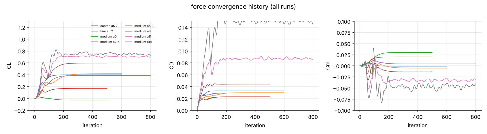

Forces settle within about 400 iterations at every angle up to 8°. At 11° and
14° the separated flow is unsteady, and the steady solver oscillates around a
mean. Those two points are averages and should be read as "stalled", not as
precise numbers.

## 3. Lift, pitching moment and the neutral point

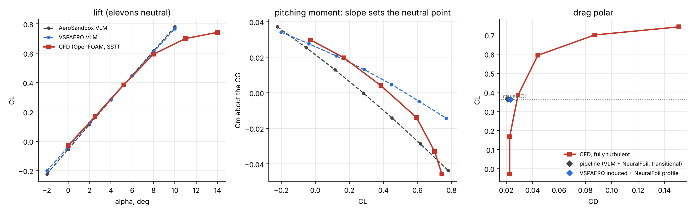

| | CL_alpha /rad | NP, mm from nose | NP, % MAC | SM at 260.5 mm |
|---|---|---|---|---|
| AeroSandbox VLM | 4.80 | 281.5 | 35.8 | 8.1 % |
| VSPAERO VLM | 4.64 | 273.5 | 32.8 | 5.0 % |
| **CFD** | **4.47** | **278.8** | **34.8** | **7.1 %** |

All three are fitted over alpha 0° to 8°. CFD's Cm(CL) is slightly curved:
the static margin grows from about 5 % near zero lift to about 8.5 % at
CL 0.5, as the first trailing-edge separation unloads the outer panels. The
7.1 % is the slope through the cruise point.

The neutral-point question from M1.7 is answered. VSPAERO's forward shift
came from its stronger induced loading. The CFD, with thickness and viscosity,
lands much closer to the AeroSandbox pipeline (1 % MAC aft of it is within
PIPE-4's 3 %; VSPAERO is 2 % MAC forward of the CFD). The CG band from M1.4
(261 to 275 mm, SM 10 to 5 %) is correct to within about 1 % MAC.

## 4. Where the lift goes, and the fin junction

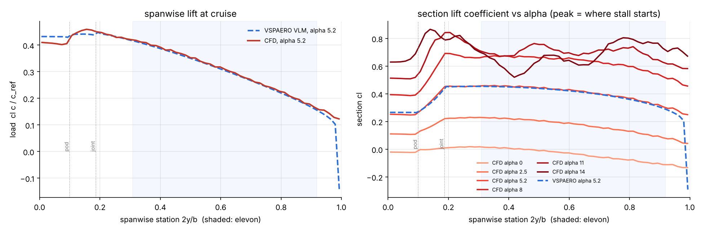

At cruise the CFD loading lies on VSPAERO's from the joint outward. The pod
carries about 5 % less load than the VLM's flat sheet (the thick MH 78 pod
generates its lift differently), and the strip next to the blend picks it up.
Section cl peaks at about 0.46 just outboard of the joint. As alpha rises,
that inboard strip runs out of lift first.

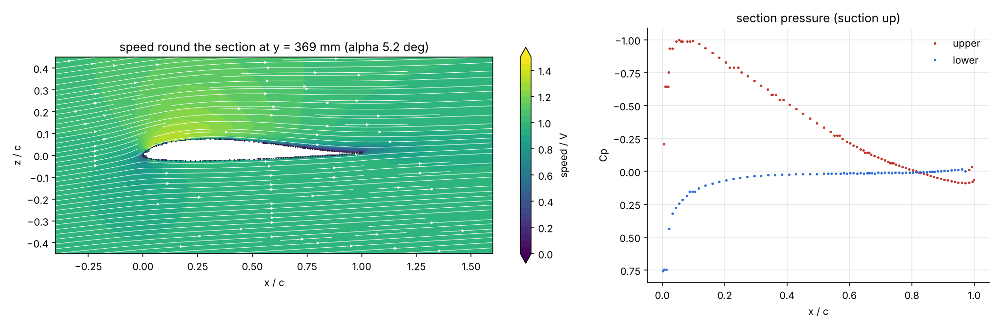

At the MAC station the flow is attached everywhere at cruise. The reflex
shows as the upper and lower Cp curves crossing at 80 % chord: the aft upper
surface carries a small download, which is what makes the wing self-trimming.

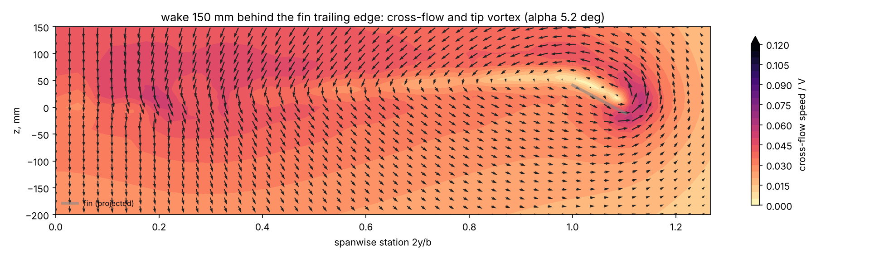

150 mm behind the trailing edge, the tip vortex rolls up at the fin tip, not
at the wing-fin joint. The drooped fin moves the vortex core outboard and
down, which is what it is there for. There is no sign of a junction vortex or
of separation in the corner. The small dimples visible in the pressure
renders are snapping artefacts of the mesh, not features of the shape.

## 5. Stall: what the CFD can and cannot say

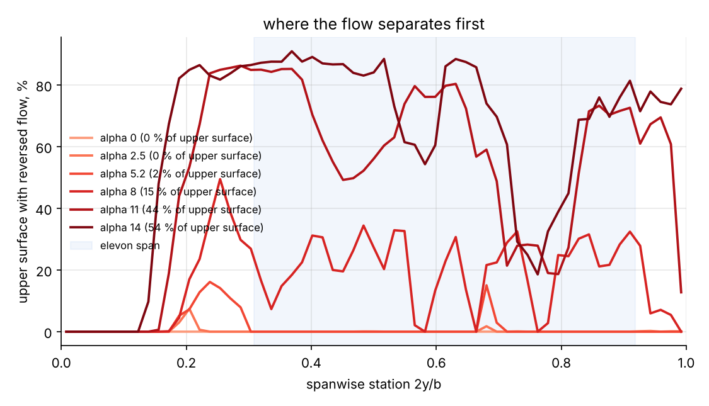

| Cruise, 5.2° | 8° | 14° |
|---|---|---|
| 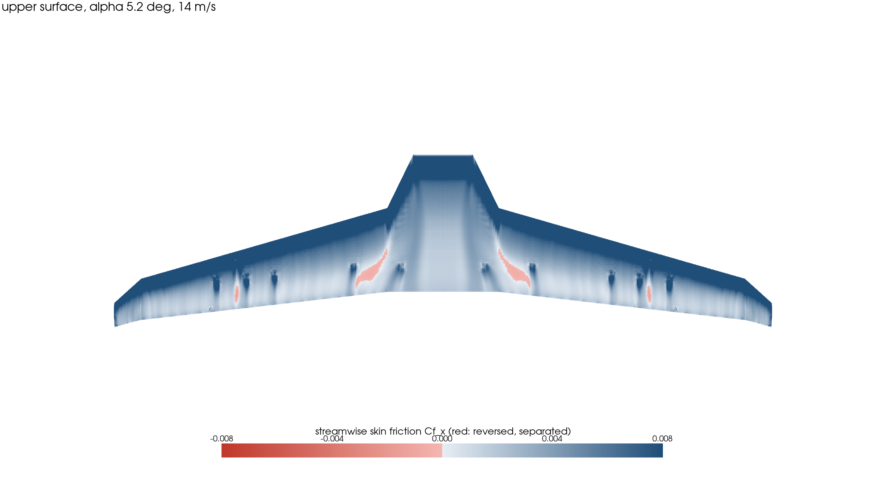 | 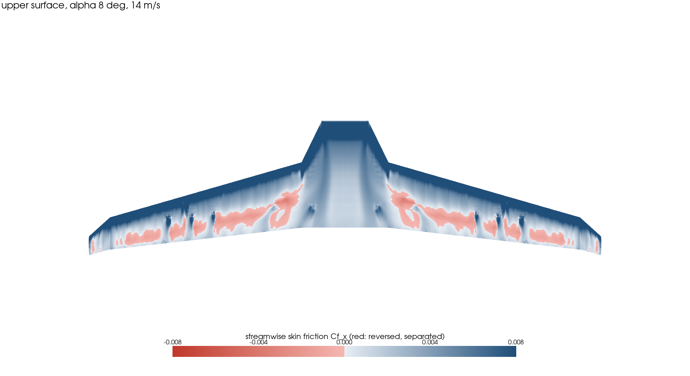 | 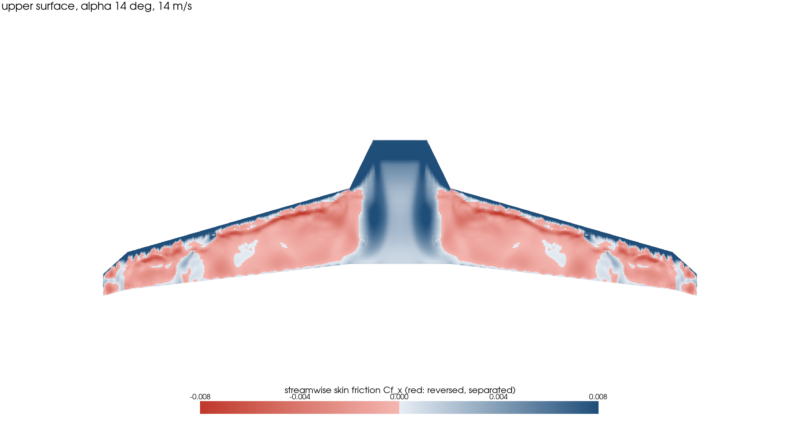 |

Red is reversed flow (separated). At cruise there is almost none (2 % of the
upper surface). By 8° a band near the trailing edge has separated, starting
just outboard of the joint (η ≈ 0.22) and in patches along the elevon span.
By 11° to 14° most of the outer panel's upper surface is separated, while the
thick pod stays attached. So the **pattern** matches the pipeline: the centre
pod is the last to go, and the stall starts at the inboard end of the outer
panels, not at the tips.

The **level** does not. The CFD wing peaks at CL 0.74, where the pipeline
assumes 0.93 trimmed. The calibration below shows why.

To test whether that is the wing or the method, the S5010 outer-panel airfoil
was run on its own: a 2-D slab with the same surface refinement, prism layers,
SST settings and Reynolds number as the 3-D case (`cfd.write_section_case`).

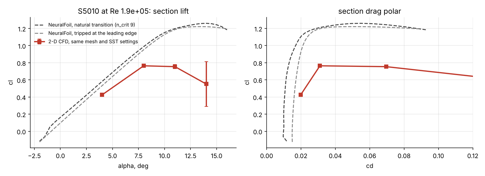

| alpha | 2-D CFD (SST) cl | NeuralFoil cl, natural | NeuralFoil cl, tripped |
|---|---|---|---|
| 4° | 0.42 | 0.58 | 0.53 |
| 8° | 0.76 | 0.99 | 0.95 |
| 11° | 0.75 | 1.20 | 1.19 |
| 14° | 0.55 (unsteady, ±0.26) | 1.26 | 1.22 |

The same solver that gives the 3-D wing a CL_max of 0.74 gives the bare
airfoil a cl_max of about 0.76, where NeuralFoil (and the XFOIL data it is
trained on) gives 1.2 to 1.26 whether the boundary layer is laminar or
tripped. So the low ceiling comes from fully turbulent SST at Re 1.9 × 10⁵,
which separates the thick trailing-edge boundary layer on a reflexed airfoil
too early. It is not a feature of the 3-D shape. The section also carries
less lift at 4°, which is consistent with the 3-D lift slope sitting 4 to 7 %
under the VLMs. A laminar/transitional model (k-ω SST with γ-Reθ, or LES)
would be needed to settle CL_max numerically; flight test is cheaper.

**What this means for the design.** Nothing changes yet: the stall speed
stays the NeuralFoil-based 8.7 m/s, but it is now the least-verified number in
the design. Two things make it safe to fly anyway: hand launch is at full
power and well above stall, and M3.3/M3.4 already plan a gentle, high stall
approach with the airspeed sensor logging. If flight test shows the real
CL_max is low, the fixes are cheap (move the CG forward a few mm, or add a
small leading-edge droop on the inboard panel) and the CFD shows where to put
them.

## 6. Drag

Fully turbulent CFD at cruise gives CD 0.028 (pressure 0.015, friction 0.013).
The pipeline's 0.021 assumes NeuralFoil's natural transition. NeuralFoil
tripped at the leading edge raises the S5010's profile drag by about 50 %,
which accounts for most of the gap. **Treat 0.028 as the upper bound and
0.021 to 0.023 as the expected value.** The glide tests in M3.4 measure it
directly. Even at the upper bound (L/D 12.8), the M1.5 energy check holds for
25 ha (it closes with L/D down to 10).

## 7. Limits of this check

* Fully turbulent RANS: no laminar runs, no separation bubbles. Fine for the
  neutral point and lift slope, an upper bound for drag, and unreliable for
  CL_max at this Reynolds number (section 5).
* Elevons neutral, so trim is shown as the Cm at the CG rather than solved.
* No propeller, skid, hatch seams or camera window.
* Steady solver: the 11° and 14° points are averages of an unsteady flow.

## 8. What changes in the design

* **Neutral point: settled.** Keep the CG band from M1.4. Fly the first
  flights at 252 mm as planned (SM about 10 %), then move aft towards 260 mm.
* **Stall speed: not settled by CFD.** It stays a flight-test item (VAL-3).
  The first stalls should be approached at height, with the airspeed logged.
* **Cruise drag: bracketed** between 0.021 and 0.028. The mission closes at
  either end.
* **Fin junction: fine.** No fairing needed for aerodynamics; M2.3 can choose
  the joint for structure alone.
