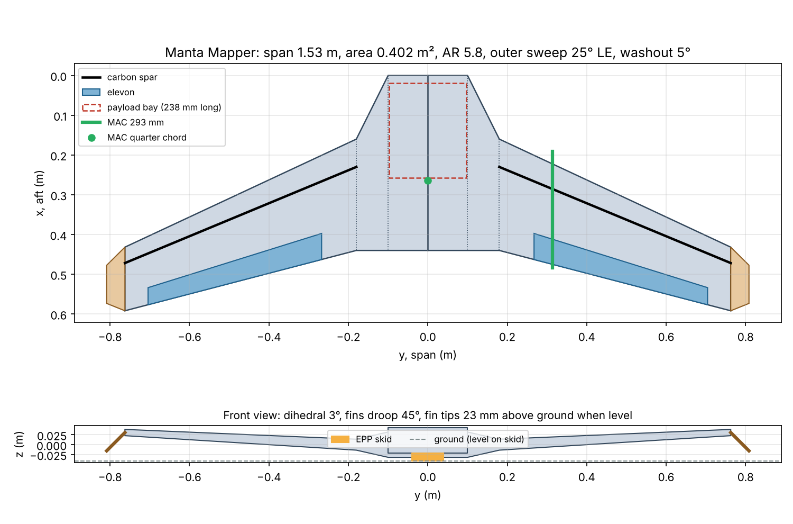
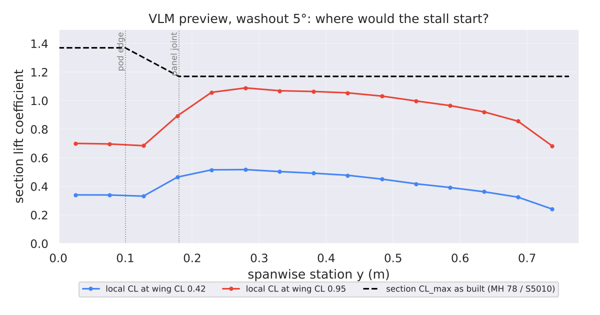

# Parametric geometry (milestone M1.3)

## The short answer

`src/manta_mapper/geometry.py` describes the whole airframe with one
dataclass, `BWBGeometry`. It builds an AeroSandbox `Airplane` from it, works
out reference area, MAC, aspect ratio, volumes, spar depth, payload-bay fit
and landing clearance, draws it, and writes OpenVSP and AVL files.

The baseline, sized from the mission file:

| | Value |
|---|---|
| Span (wing) / overall with fins | 1.525 m / 1.62 m |
| Wing area / aspect ratio | 0.402 m² / 5.8 |
| Mean aerodynamic chord | 293 mm |
| Centre pod | 440 mm chord × 200 mm wide, MH 78, 58 mm inside height |
| Outer panels | 583 mm long, 280 → 160 mm chord, 25° LE sweep, 3° dihedral, 5° washout, S5010 |
| Tip fins | 65 mm long, drooped 45°, swept 35° |
| Elevons | 25 % chord, from 15 % to 90 % of each outer panel |
| Spar | 10 mm carbon tube at 25 % chord, 632 mm per panel; 27 mm deep at the root, 16 mm at the tip |
| Stall at 1.5 kg, field, 32 °C | 8.8 m/s (limit 9) |



```bash
python -m manta_mapper.geometry config/mission.toml --plots docs/img --vsp manta.vspscript
```

## What each parameter means

Right half described; the left is a mirror. x points aft from the pod's
leading edge, y to the right wingtip, z up.

### The overall size

- **`span_m`**: tip to tip of the flat wing, seen from above. The drooped fins
  stick out a little further (`overall_span_m` is the "will it fit in the car"
  number). The baseline function solves for this so the wing area meets the
  stall requirement; everything else stays as set.

### Centre pod

- **`pod_chord_m`**: front-to-back length of the pod. Its depth is 14.4 % of
  this (the MH 78 section), so this is really the "how tall is the payload
  bay" knob.
- **`pod_half_width_m`**: half the pod's width. The pod has a constant chord
  and no sweep, so it is a simple box to print and a simple bay to pack.
- **`blend_width_m`**: the short strake that tapers the pod into the outer
  panel. The pod's and panel's trailing edges line up (straight TE for the
  pusher prop and an easy-to-cut hinge line), so the leading edge here sweeps
  back steeply (63° on the baseline). That steep strake is what gives the
  "manta" look. Its section morphs from MH 78 to S5010.

### Outer panels

- **`root_chord_m`, `tip_chord_m`**: chord where the panel plugs into the pod,
  and at the tip. Straight taper between them.
- **`sweep_le_deg`**: how far back the leading edge leans. Sweep moves the tips
  (and their elevons) behind the centre of gravity, which is what lets a
  tailless wing balance in pitch.
- **`dihedral_deg`**: upward tilt of the panels. Small, because sweep already
  adds roll stability; mainly here so the drooped fins clear the ground.

Every line on an outer panel is straight (leading edge, trailing edge, spar,
hinge line, twist). That is deliberate: a hot-wire foam cutter running between
a root template and a tip template produces exactly this shape, and a straight
carbon tube slides through it. A test checks it stays that way.

### Twist

- **`root_twist_deg`**: incidence of the panel root relative to the pod.
- **`washout_deg`**: how far the tip is twisted *nose-down* compared with the
  panel root, varying linearly. Washout does two jobs on a flying wing:
  1. **Stall safety.** It unloads the tips, so the inner wing stalls first,
     the nose drops, and the elevons (on the tips) keep working. A tip stall
     drops a wing, which on a hand launch means a cartwheel.
  2. **Trim.** On a swept wing the tips are behind the CG, so twisting them
     nose-down makes a nose-up moment. Together with the reflexed airfoils,
     this lets the wing fly level with the elevons near neutral (AC-8).
- **`pod_twist_deg`**: incidence of the pod. Left at zero; the camera mount
  angle (CAM-4) will be set from the cruise angle of attack in M1.4.

### Tip fins

- **`fin_length_m`, `fin_droop_deg`, `fin_sweep_le_deg`, `fin_taper`**: the
  wingtips bend down and back. A tailless wing has no fin, so these provide
  yaw stability and act as winglets. Drooping them (rather than pointing them
  up) is the look, but it puts them close to the ground on landing, so the
  geometry reports `fin_ground_clearance_m`: how high the fin tips sit when the
  aircraft rests level on its skid. The baseline has 23 mm, so a level belly
  landing touches the skid first. With any bank over about 1.6° a fin touches
  first, which is why the fins are separate replaceable parts (AC-11, AC-13).

### Controls, structure, landing

- **`elevon_chord_fraction`, `elevon_start`, `elevon_end`**: elevons on the
  outer panels only, 25 % chord (generous for low-speed authority on launch),
  stopping short of the tip so the fin joint has solid material.
- **`spar_chord_fraction`, `spar_diameter_m`**: where the carbon tube runs and
  how big it is. The geometry checks the section is deep enough at the tip
  (the thinnest point) with 1 mm of material above and below.
- **`skid_depth_m`**: 20 mm sacrificial EPP skid under the pod. Deeper than
  the bare minimum so it absorbs more landing energy and keeps the fins off
  the ground.
- **`payload`**: rough boxes for battery, flight controller, Pi, camera, ESC,
  receiver/Remote ID and GPS. `payload_fit()` checks that the pod has a long
  enough stretch with enough inside height, and that the items' floor area,
  divided by a 60 % packing efficiency, fits in it. It is a forgiving first
  check; the scripted CAD (M2.3) does the real packing.

`BWBGeometry.DESIGN_VARIABLES` lists the 14 numbers the optimizer (M1.6) will
move. The rest are build settings.

## How the baseline is sized

1. Target area = what a 9 m/s stall needs at 1.5 kg in the design-day air at
   the field, with the wing CL_max of 0.95 from [airfoils.md](airfoils.md),
   **plus 5 %**. That gives 0.402 m² and an estimated stall of 8.8 m/s rather
   than exactly 9: margin for the CL_max estimate being optimistic.
2. The pod is sized by the payload, not the wing, so it stays fixed. The
   outer-panel chords stay fixed too, and the span is solved to hit the area.
   The result, 1.525 m, lands close to the first-cut 1.48 m.

Other choices and why:

| Choice | Why |
|---|---|
| Pod 440 mm chord | 58 mm inside height, room for the 23 mm battery pack with plenty to spare; bay is 238 mm long with the depth needed |
| 25° LE sweep | enough tip moment arm for trim and pitch control without making the tips very lightly loaded or the panels long |
| Taper 0.57 | close to an efficient lift distribution; the 160 mm tip keeps 16 mm of depth for the spar and a tip Reynolds number around 75,000 at stall |
| 5° washout | see the preview below: tips stall last with a large margin, and the wing trims with no elevon at a 7.5 % static margin |
| 10 mm spar at 25 % chord | the thickest part of the S5010; straight across the panel |

## VLM preview: does the shape behave?

The full aero and stability work is M1.4. A quick AeroSandbox vortex-lattice
run is included now, because the washout and sweep can't be picked blind:

| Quantity | Baseline |
|---|---|
| Lift slope | 0.074 per degree |
| Neutral point | 33.6 % MAC (x = 290 mm) |
| Zero-lift Cm about the MAC quarter chord | +0.028 (nose-up: self-trimming) |
| Cm at cruise about a CG at 7.5 % static margin | −0.002, about zero, so it trims with elevons near neutral |
| Cruise angle of attack | about 6° |



The plot is the washout check from the airfoil study. At the wing's estimated
CL_max (0.95), the most heavily loaded section is just outboard of the panel
joint (local CL 1.09 against 1.17 available), while the tip strip is at only
0.68. So the stall starts inboard and the tips, with the elevons, keep flying.
The pod is lightly loaded (0.70 against MH 78's 1.37), so it is nowhere near
stalling.

Things to keep in mind about the preview:

- It is inviscid and treats the wing as a thin cambered sheet. The pod's
  thickness, the real stall, and drag are not in it. Use it to compare shapes.
- "Centre stalls first" from the airfoil notes really means "the inner wing
  stalls before the tips", which this does. The pod itself stalls last.
- About 6° angle of attack at cruise means the pod flies nose-up. The camera
  must point straight down within 3° (CAM-4), so either the camera mount is
  tilted to match or the outer panels get more incidence relative to the pod
  (`root_twist_deg`). M1.4 settles which, once trim is computed properly.

## Exports

- `geom.to_airplane()`: AeroSandbox `Airplane` (wing + tip fins as separate
  surfaces, elevons as control surfaces, reference values from the wing).
- `geom.export_openvsp(path)`: an OpenVSP `.vspscript` (File → Run Script) for
  the VSPAERO check in M1.7.
- `geom.export_avl(path)`: an AVL file, handy as an independent cross-check.

## Not covered yet

- Masses and CG (M1.5), so the static margin is assumed, not computed.
- The pusher prop and motor mount: the prop sits at the pod trailing edge;
  belly landings will need a folding prop (M1.5 propulsion).
- Hatches, joints and wall structure: scripted CAD, M2.3.
