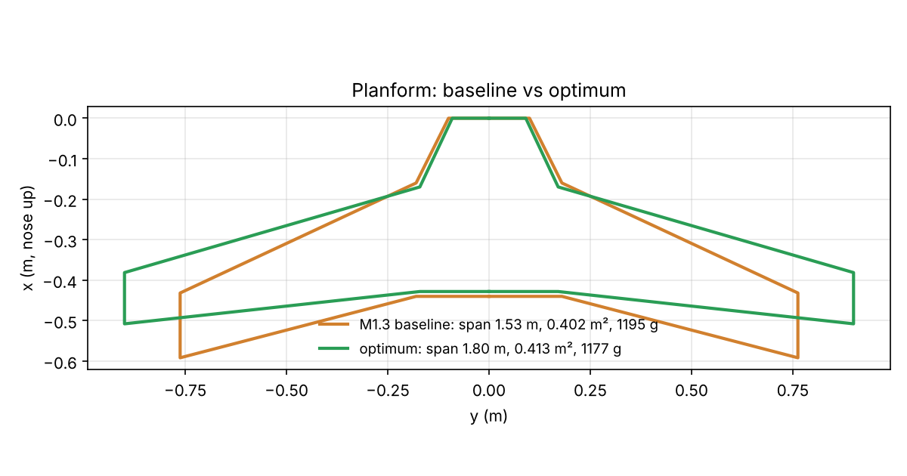
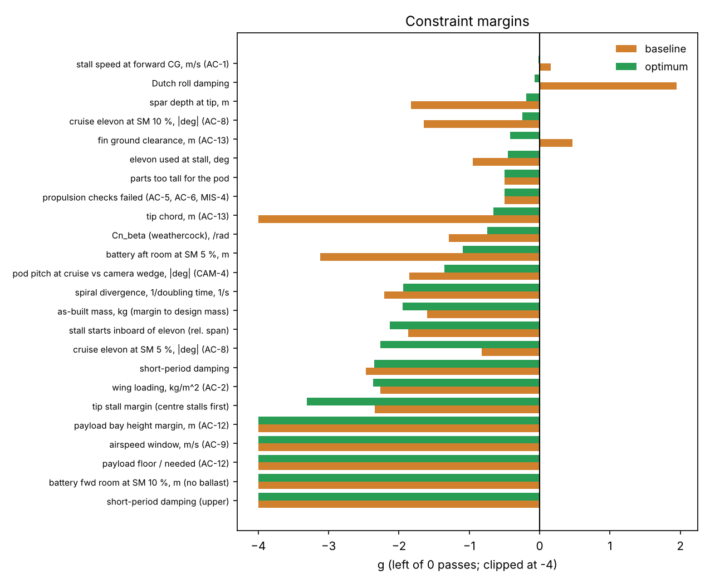
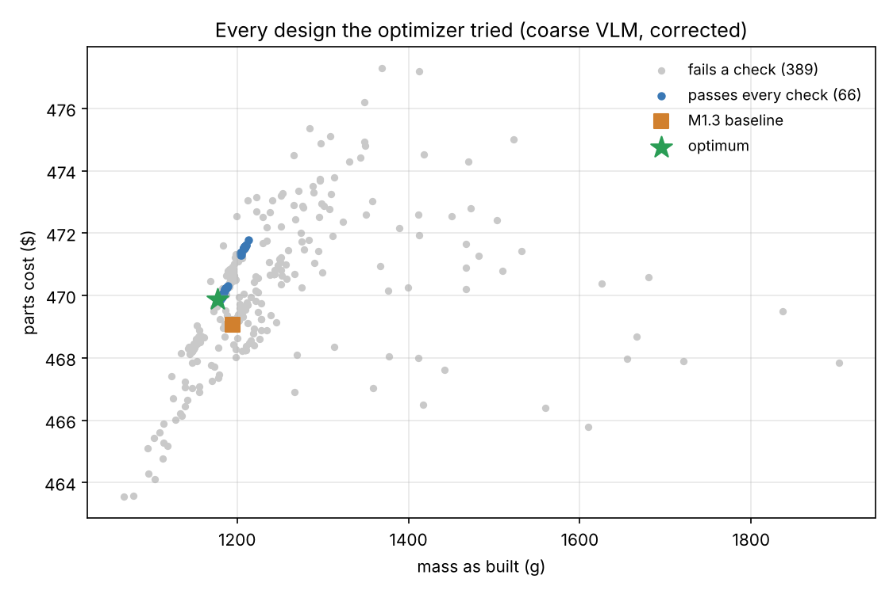

# Design-to-cost optimizer (milestone M1.6)

> **Re-run after M1.7 (2026-11-28).** The VSPAERO check found that AeroSandbox
> applied pitch and yaw rates about the pod nose instead of the CG, so the
> original optimum's Dutch roll damping (0.092) was really about 0.07 (see
> [vspaero.md](vspaero.md)). With the fix, the optimizer was re-run with the
> same robust margins (Dutch roll >= 0.09). **New optimum: span 1.80 m
> (at the upper bound), AR 7.8, LE sweep 16°, dihedral 2.3°, fins 100 mm
> drooped 23°, pod 428 x 182 mm; Dutch roll 0.091, stall 8.79 m/s, 1177 g as
> built, $470.** All three finalists sit at the 1.80 m span bound, which means
> the span limit is now an active constraint. [optimizer_report.txt](optimizer_report.txt), [optimizer_result.json](optimizer_result.json)
> and the plots are from the re-run. The tables below still describe the
> original run. The new optimum has not been through VSPAERO yet, and it
> still uses the VLM neutral point, which VSPAERO puts about 3 % MAC further forward.

## The short answer

| Question | Answer |
|---|---|
| Does the M1.3 baseline pass everything? | **Almost.** It misses one check: Dutch roll damping is 0.073, and the yardstick is ≥ 0.08 |
| What did the optimizer find? | A design that passes **every** check, with extra margin on the ones the search pushes against: **stall 8.70 m/s** at the forward CG (limit 9), **Dutch roll 0.092**, fins 26 mm off the ground |
| Is it cheaper and lighter? | Yes, a little: **1163 g as built (−32 g), $468 (−$1)**. Same motor, prop, pack and ESC |
| What changed in the shape? | **Span 1.53 → 1.67 m** at about the same area (aspect ratio 5.8 → 7.0), more taper (tip 160 → 127 mm), 3° less sweep, less washout (5.0 → 3.3°), 1° more dihedral, fins 65 → 85 mm, pod 18 mm shorter and 30 mm narrower |
| Why so little saving? | Most of the cost is bought parts (avionics, camera, propulsion: ~$380 of $468) that don't depend on the shape. Across every design tried, the parts cost only moves by about ±$7. Weight moves more, but the 1.5 kg sizing mass fixes the wing area, so there isn't much structure to remove |
| What's tight now? | The 10 mm spar fits the tip with 0.4 mm to spare. Cruise trim at the forward CG uses 2.8° of the 3° budget. The pack has 5 mm of room left when sliding back for the aft CG. The pod is at its narrowest allowed width (170 mm). None of these fail, but they're the things to watch in CAD (M2.3) |
| Recommendation | **Adopt the optimum** as the M1.7 (VSPAERO) candidate, with the other two finalists as alternates. It fixes the one open stability item with margin and has better stall and L/D (model 16.9 vs 16.2) |

One command does the whole run, in about 15 minutes on 4 cores:

```bash
pip install -e ".[dev]"
python -m manta_mapper.optimize config/mission.toml --screen 160 --polish 4 --maxiter 80 \
    --report docs/optimizer_report.txt --json docs/optimizer_result.json --plots docs/img
```

`--quick` checks the plumbing in about 3 minutes. `--margins standard` uses the
bare requirement limits instead of the extra margins (see section 3).
The full report is [optimizer_report.txt](optimizer_report.txt). The
optimum, the finalists and every constraint value are in
[optimizer_result.json](optimizer_result.json) for M1.7 to read.



## 1. What is being optimized

**Objective: parts cost + $100/kg × as-built mass.** "Lowest cost, lightest"
needs one number, so weight gets a price: 100 g is worth $10. The ranking is
re-run at $0/kg and $300/kg. The same design wins at all three, so the price
doesn't matter here.

**Ten design variables** (the M1.3 set, minus four that stay fixed):

| Variable | Bounds | Baseline | Optimum |
|---|---|---|---|
| span | 1.30–1.80 m | 1.525 | **1.668** |
| outer-panel root chord | 0.22–0.34 m | 0.280 | 0.279 |
| taper (tip / root) | 0.40–0.90 | 0.57 | **0.46** |
| leading-edge sweep | 12–35° | 25.0 | **22.4** |
| washout | 2–8° | 5.0 | **3.3** |
| dihedral | 0–6° | 3.0 | **4.0** |
| fin length | 50–110 mm | 65 | **85** |
| fin droop | 20–60° | 45 | 44 |
| pod chord | 0.38–0.50 m | 0.440 | **0.422** |
| pod half-width | 85–120 mm | 100 | **85** (at the bound) |

Taper replaces tip chord so the optimizer can't ask for a tip bigger than the
root. Held fixed: blend width, root twist (M1.4 chose a tilted camera mount
instead), elevon chord (25 %, generous for low-speed authority) and spar
position (25 % chord).

**Sizing mass stays at 1.5 kg.** Every aerodynamic, stall and propulsion
check runs at 1.5 kg, as M1.5 recommended, even though the build-up says
~1.16 kg. The weight saved shows up as margin, not as a smaller wing.

## 2. What each evaluation does

Each candidate shape goes through the whole M1.3–M1.5 chain:

1. **Geometry checks**: payload floor area and bay height (AC-12), spar fits at the tip, fin
   ground clearance (AC-13), tip chord.
2. **Vortex lattice**: lift, moment and elevon slopes, so the neutral point and the 5–10 % CG band.
3. **Trim**: cruise elevon at both ends of the CG band (AC-8), pod pitch at cruise vs the 6° camera wedge (CAM-4).
4. **Stall**: critical-section method, trimmed, at the **forward CG (10 % static margin)**,
   which is where first flights happen and the stall is highest. Also: where the stall starts
   and how much margin the outer elevon has, and how much elevon the stall trim uses.
5. **Trimmed drag polar** at the design CG, fitted with a quadratic.
6. **Propulsion**: the M1.5 checks (hand-launch thrust, climb gradient, climb rate, top speed,
   currents, pack size, 25 ha at L/D 10 and 50 ha at L/D 12) with this shape's polar and stall speed.
7. **Weight build-up**: as-built mass, cost, battery placed for the forward CG, and whether the pack can
   also slide back far enough for the aft CG without ballast.
8. **Flight modes**: stability derivatives at cruise, inertia from the build-up scaled to 1.5 kg;
   Dutch roll, short period, spiral.

That's 24 constraints. Each is written as `g ≤ 0` passes, scaled by a
"typical size" (0.5 m/s for stall, 0.02 for Dutch roll damping, 5 mm for
clearances, and so on). `g = −1` means one typical size of margin, which makes
the margins comparable across checks:



## 3. Margins: forgiving, not tight

An optimizer always ends up on some limits. Left alone, it put the stall at
8.99 m/s and Dutch roll at exactly 0.080 (the `--margins standard` run:
1157 g). That's legal on paper, but any modelling error pushes it over. So the
default run asks for more on the three constraints it pushes against hardest:

| Constraint | Requirement | Optimizer target | Optimum |
|---|---|---|---|
| Stall at the forward CG, 1.5 kg, design day | ≤ 9.0 m/s (AC-1) | **≤ 8.8 m/s** | 8.70 |
| Dutch roll damping | ≥ 0.08 | **≥ 0.09** | 0.092 |
| Fin ground clearance | > 0 (AC-13) | **≥ 25 mm** | 26 mm |

Those margins cost 6 g compared with the standard run. Other margins carried over from
earlier milestones: outer half of the elevon ≤ 90 % of its CL_max when the wing
stalls (centre stalls first), ≤ 15° of the 20° elevon throw used at the stall,
pod within 2° of the camera wedge (of the 3° CAM-4 budget), tip chord ≥ 120 mm,
and as-built mass ≤ 85 % of the 1.5 kg design mass.

## 4. How the search works

A full-resolution evaluation takes ~55 s, mostly the stall sweep and the
derivatives. Ten variables and hundreds of evaluations don't fit that, so the
search runs in three steps:

1. **Calibrate.** Run the baseline at full and at coarse VLM resolution (2 × 6
   panels per section instead of 4 × 10, 2° stall steps instead of 1°, 5 polar
   points instead of 13). Keep the difference in each aerodynamic output as an
   additive correction. A coarse run takes ~4.5 s. On a quite different test
   shape (30° sweep, taper 0.45, 1.6 m span), the corrected coarse values matched
   full resolution within 0.03 m/s on stall, 0.002 on Dutch roll damping and 0.1° on trim.
   Spiral is tracked as 1/doubling time, because the time itself blows up near zero and corrects badly.
2. **Screen.** 160 designs from a Latin hypercube, in parallel. **None of
   them passed every check.** The feasible region is a narrow pocket near the
   baseline, and that is a finding in itself. The screen's job is to give
   the polish varied starting points.
3. **Polish.** COBYLA (derivative-free, handles inequality constraints) from
   the three best distinct screened designs and from the baseline, up to 80
   evaluations each. It aims a little inside every limit (0.2 typical sizes,
   e.g. 0.1 m/s on the stall), so the coarse-vs-full scatter can't push the
   answer over an edge.

Then the three best distinct designs are re-run at **full resolution with the
whole propulsion catalogue**. If the best one fails there, the correction is
recalibrated at that design and the polish repeats (up to 3 rounds). The final
run passed in the first round: 443 evaluations, 55 feasible.



The plot shows the cost spread: every design tried lands between $463 and $477.

During search, propulsion only tries the motor/prop/pack sets that pass the
checks that don't depend on the shape (static thrust and current at full
throttle). In the current catalogue that's one set, the M1.5 choice. The
cheaper A2212 near miss fails on current at 1.5 kg whatever the wing looks
like. The full catalogue is re-checked on the finalists.

## 5. Why the optimum looks the way it does

- **Longer span, same area.** A higher aspect ratio gives more roll damping
  and less induced drag, both of which help Dutch roll. Taper and less sweep
  keep the area and tip loading in check, and the optimizer could take out
  some washout (which costs lift) while keeping the stall inboard. The outer
  elevon still has 19 % margin when the wing stalls.
- **Bigger fins plus more dihedral.** Longer fins add yaw damping and
  weathercock stability (Dutch roll). Longer drooped fins would hit the ground
  on a belly landing, though: on the baseline, 90 mm fins at 45° droop leave
  5 mm. The extra degree of dihedral lifts the tips so the 85 mm fins
  still clear by 26 mm. The optimizer found this coupling by itself.
- **Smaller pod.** The pod is the heaviest structural item (322 g as built), so it
  shrinks until the payload still fits with room left: floor area 1.7× the
  packed payload and 22 mm of headroom. It stops at the 170 mm width bound, and the bay
  could go narrower. The bound is there for hatch access and the side-by-side layout in M1.5.

## 6. Results compared

At full resolution, 1.5 kg, design day:

| | Baseline | Optimum |
|---|---|---|
| Span / area / aspect ratio | 1.525 m / 0.402 m² / 5.8 | 1.668 m / 0.399 m² / 7.0 |
| Stall at the forward CG | 8.88 m/s | **8.70 m/s** |
| Outer elevon margin at the stall | 22 % | 19 % |
| Neutral point | 33.6 % MAC (290 mm) | 34.4 % MAC (282 mm) |
| Cruise L/D (model) | 16.2 | **16.9** |
| Cruise power at L/D 12 (planning) | 38.7 W | 39.1 W |
| Dutch roll damping | 0.073 ✗ | **0.092** |
| Short period | 1.67 Hz, damping 0.66 | 1.78 Hz, damping 0.66 |
| Spiral doubling time | 26 s | 22 s (yardstick ≥ 12 s) |
| Structure as built | 617 g | 585 g |
| Mass as built | 1195 g | **1163 g** |
| Parts cost | $469 | **$468** |

Cruise power hardly changes, because the planning case fixes L/D at 12. The
model's better L/D counts only if the flight tests show it (VAL-1, VAL-2).

## What this changes downstream

- **M1.7 VSPAERO**: run the optimum and the two other finalists (all three in
  `optimizer_result.json`). Dutch roll is the constraint to compare first.
  The VLM has no thickness, and VSPAERO's panel method will show whether the 0.092 holds up.
- **M2.2 structure**: the spar has only 0.4 mm of cover at the tip. A tapered spar
  (10 mm inboard, 8 mm outboard) or a 10 × 8 tube that stops a little short of the tip would add margin.
- **M2.3 CAD**: the pod is 422 × 170 mm. Check the hatch and the side-by-side
  FC/Pi layout first, since the pod is now at the narrow bound.
- **Battery tray**: the pack has 5 mm to spare at the aft CG (5 % static margin).
  Fine for first flights at the forward CG, but don't move other parts aft.
- The M1.4 and M1.5 reports describe the baseline. They'll be rerun on the chosen
  design once M1.7 confirms it.

## Limits

- The search is local in practice. The screen found no feasible designs, so the
  answer depends on the polish starting points. Three runs with different
  margins all ended in the same family: about 1.52–1.67 m span, taper 0.43–0.50,
  22–26° sweep, a shorter and narrower pod, and 32–50 g saved. A different
  pocket somewhere else isn't ruled out.
- The coarse-to-full correction is additive and calibrated at one design. The
  full-resolution check on the finalists is what certifies the result.
- Cost is a catalogue estimate, as in M1.5. The cost objective can only
  move structure cost (foam, filament, carbon) and the propulsion set. Bought
  avionics are fixed by the requirements.
- Packaging is the M1.5 centreline check. The real packing happens in CAD (M2.3).
