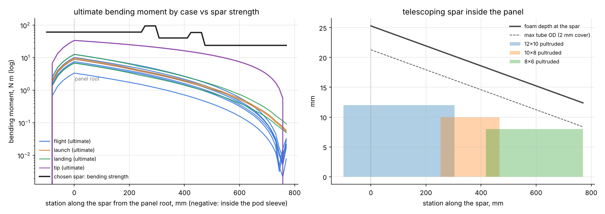
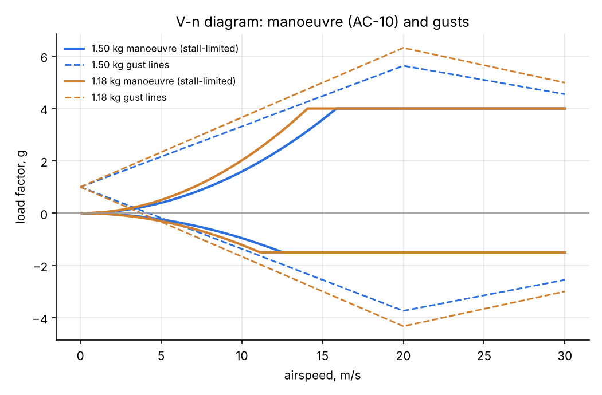

# Spar, load cases and the panel joint (milestone M2.2)

`structures.py` sizes the carbon spar of each removable outer panel, the sleeve
it plugs into in the pod, and the carry-through that joins the two sleeves. It
runs on the merged 1.84 m optimum (`docs/optimizer_result.json`).

```bash
python -m manta_mapper.structures config/mission.toml --report docs/structures_report.txt --json docs/structures_result.json --plots docs/img
```

Full numbers: [structures_report.txt](structures_report.txt).

## The answer

| | |
|---|---|
| **Spar (each panel)** | Three pultruded carbon tubes that telescope, each nesting inside the next: **12x10 mm** from 100 mm inside the pod to 303 mm out, **10x8 mm** from 253 to 467 mm, **8x6 mm** from 417 mm to the tip (770 mm). The 50 mm overlaps are bonded with epoxy. Cut lengths per panel: 403, 214 and 353 mm, so one 1 m stick of each size does both panels |
| **Sleeve in the pod** | 14x12 mm roll-wrapped tube, 120 mm, bonded through two printed ribs (8 mm web, 15 mm boss round the sleeve). The spar slides in 100 mm |
| **Anti-rotation** | The M1.5 3 mm carbon pin at 60 % chord carries the panel torque (13 % of allowable) |
| **Carry-through** | One 10x1 mm pultruded carbon strip bonded along the pod floor and one along the roof at x ≈ 205 mm, 36 mm apart, each bonded for 80 mm or more past each rib. The roof strip must not be cut by the hatch (M2.3) |
| **Retention** | Launch pulls each swept panel out of its sleeve with about 6 N. Hold it with at least 19 N, and choose a catch that lets go at roughly 3x that, so a cartwheel pops the panel off instead of breaking the sleeve |
| **Mass and cost** | Spar + sleeves + caps 113 g as built, **+32 g** on the M1.5 assumption. Aircraft 1182 → **1214 g** (81 % of the 1.5 kg sizing mass), parts **+$27** (~$497). `weights.py` now uses this spar by default |

Margins (all at ultimate, 1.5 × limit):

| Check | Value | Limit |
|---|---|---|
| Spar strength, bending + torsion | 0.56 of allowable | ≤ 0.80 (robust margin on top of the 1.5 factor) |
| Crushing where the spar enters the sleeve | 0.22 | ≤ 0.80 |
| Rib boss bearing / sleeve bond (repeated cases at half strength) | 0.37 / 0.59 | ≤ 0.80 |
| Tube buried with 2 mm of EPP top and bottom | +0.4 mm spare at the tightest point | ≥ 0 |
| Tip deflection in level flight at 1.5 kg | 4.3 mm | ≤ 12 mm |
| Elevon reversal speed | 45 m/s | ≥ 36 m/s (1.2 × the 30 m/s dive speed) |

## Why not the single 10x8 tube from M1.5

Two reasons, both new with the 1.84 m wing:

1. **It doesn't fit.** The tip chord shrank to 127 mm, so the S5010 is only
   12.4 mm deep at the spar. A 10 mm tube would leave 1.2 mm of EPP above and
   below it, and EPP that thin splits. With 2 mm of cover, the tube at the tip
   can be at most 8.4 mm. A telescoping spar follows the taper: the largest
   tube that fits at each station.
2. **Tip strikes.** The drooped fins sit 26 mm above the ground and touch at
   about 1.5° of bank (geometry report), so a fin catching the dirt happens on
   most landings. The fins are taped on and the tape lets go at some force
   (30 N assumed). That force on a 770 mm lever is the biggest bending moment
   the spar ever sees, about 23 N·m at the root. A 10x8 tube would be at 0.85
   of its strength at ultimate; the 12x10 root tube is at 0.56.

The telescoping spar is also stiffer (4.3 mm tip deflection vs 7.0 mm; elevon reversal 45 vs 40 m/s) and
less twisty, for 10 g more spar tube.

## Load cases



Every load is a 3-D force at a point; the moment about each spar station is
split into bending and torsion, so sweep, dihedral and launch loads (which are
chordwise) are all handled the same way. Limit loads at the panel root:

| Case | Root bending, N·m | What sets it |
|---|---|---|
| Manoeuvre +4 g at 1.5 kg (AC-10) | 6.0 | |
| Gust +7.6 m/s at 20 m/s, 1.5 kg | **8.5** | the flight case that governs (+5.7 g, stall caps it at 5.6 g) |
| Hand launch | 6.0 | 11 m/s over a 0.7 m arm swing, peak 1.5x average: 13 g fore-aft on the panels |
| Bungee catapult (stretch goal) | 6.5 | 13 m/s over 1.2 m, peak 2x: 14 g |
| Belly landing, 1.5 m/s sink | 4.6 | stopped over 12 mm of skid and dirt: 10 g, no lift relief |
| Hard landing once, 2.5 m/s | 12.7 | 27 g, checked at ultimate without the 1.5 factor |
| **Tip strike, 30 N** | **22.9** | the fin tape's release force |

**Gusts beat the 4 g of AC-10.** The as-built wing loading is only about
28 N/m². The Pratt gust formula (with its alleviation factor) gives +5.7 g at
1.5 kg and +6.3 g at 1.18 kg in a 7.6 m/s gust at 20 m/s, which is summer
thermal country. The spar is sized for the gust lines as well as the 4 g; AC-10
itself is unchanged.



**Landings are not a spar problem.** The panels are light (~150 g each with
the spar), so even a 4 m/s arrival (68 g over 12 mm) uses only 39 % of the
spar's strength. The landing sweep in the report shows this. What AC-13 really
tests is the skid, the fins and the pod floor, plus the restraint of the
heavy parts inside:

| Part | Fore-aft (launch), ultimate | Down (landing), ultimate |
|---|---|---|
| Battery (237 g) | 50 N | 37 N |
| Motor (71 g) | 15 N | 11 N |
| ESC, FC, servos | 5 to 8 N | 4 to 6 N |

A velcro strap alone will not hold the battery at 50 N fore-aft. The tray
needs a printed stop at each end (for M2.3).

**The tip-strike force is the number to measure.** It sets the spar. Pull-test
the fin tape at M2.4: if it lets go well under 30 N, there is more margin; if it
holds past 40 N, use less tape or a weaker peg, because the fin is meant to be
the part that gives.

## Elevon reversal

A pultruded tube has all its fibres along its length, so it is stiff in bending
but soft in torsion (G ≈ 4.5 GPa), and EPP is softer still. When an elevon goes
down it twists the panel nose-down, which takes back some of the lift it adds.
Above some speed the elevon stops rolling the aircraft at all. The model uses
strip theory, thin-aerofoil flap moments, and the torsional stiffness of the
tube plus half that of the film-covered EPP box ahead of the hinge. For this
spar, reversal is at about 45 m/s, against a 30 m/s dive speed. Roll-wrapped
tubes (G ≈ 12 GPa) would raise it further, but they cost $4 to $5 more per
stick and aren't needed here. They are used for the sleeve, where their hoop
fibres resist crushing.

## Lift shape cross-check

The lift shape comes from the AeroSandbox VLM at CL 0.9. With washout, the
load moves outboard as alpha rises, so a near-stall shape is the conservative
one for root bending. Compared with the VSPAERO cruise run (M1.7b), the share
of lift on the outer panel matches (37 % vs 37 %), and the centroid sits 21 mm
further out, so the root moment is about 6 % high. Schrenk's approximation
(`--schrenk`, no AeroSandbox needed) picks the same spar.

## Assumptions to test

These are placeholders, and each has a test at M2.4 or M3.1:

- **Tube properties:** pultruded E 115 GPa, 700 MPa bending (knocked down from
  datasheet ~1.2 GPa); roll-wrapped E 85 GPa, G 12 GPa. Check by
  sandbag-loading the assembled wing to 1.5x the gust case (AC-10 wingtip load
  test).
- **Printed LW-ASA bearing:** 10 MPa ultimate; epoxy on sanded ASA 2 MPa lap
  shear. Test print the rib boss and sleeve and pull it.
- **Fin tape release force:** 30 N. Pull test.
- **Landing stroke:** 12 mm. The landing log (AC-13) and the flight
  controller's IMU log of the first landings give the real deceleration.
- **Flutter:** not analysed. The spar sits at 25 % chord, near the aerodynamic
  centre, and the panels are swept back, so divergence is not a concern.
  Flutter is unlikely at 30 m/s, but check it with a shallow dive in the
  manual flights (M3.4). The pilot should watch for buzzing elevons.

## What the CAD (M2.3) needs from this

- Spar line at 25 % chord, swept 13.8°, 770 mm per panel. Sleeve inner end at
  x = 205 mm, y = ±74 mm.
- Panel foam channel for the stepped tube: 12 mm to 303 mm, 10 mm to 467 mm,
  8 mm to the tip.
- Two printed ribs per side, at the panel root face and at the sleeve's inner
  end, each with a 15 mm boss bonded to the sleeve.
- Floor and roof strip caps between the ribs, the roof one clear of the hatch
  cut-out.
- A battery tray with printed end stops.
- A panel catch holding at least 19 N.

If the CFD thread (M2.1) moves the CG, nothing here changes. The battery
slides, and the spar loads don't depend on the CG.
