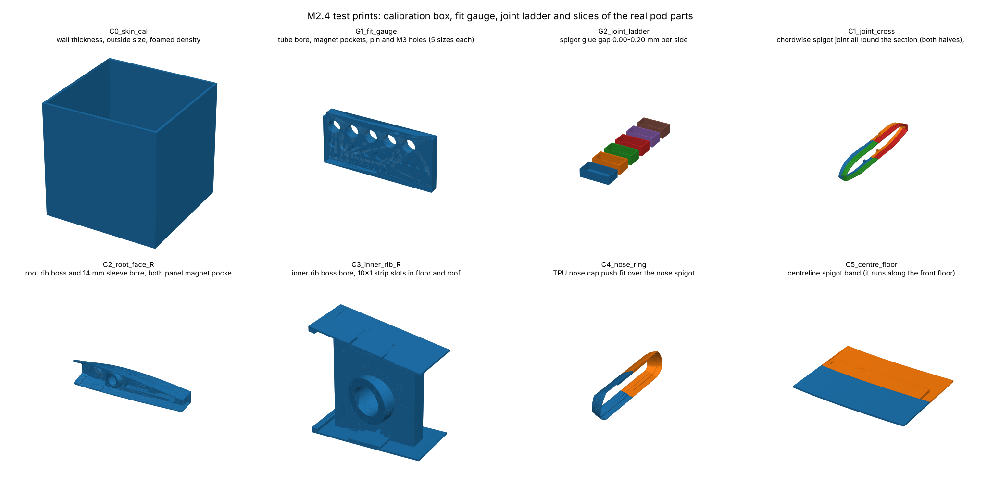

# Test prints (milestone M2.4)

The four pod sections are about 15 hours of LW-ASA. Before that, a few short
prints (about 4 hours of LW-ASA in all, plus the small real parts) check three
things. The filament has to foam to the density the weights assume. The
printer has to hit the CAD's clearances. And the joints, bores and pockets have
to fit the real tubes, magnets and motor. Every check has a number or a yes/no
answer that you write into a CSV file. One command then tells you what passes,
what to change in the CAD, and where the aircraft's mass and CG now stand.

```bash
pip install -e ".[dev]"
python -m manta_mapper.testprints generate --out cad/testprints --render docs/img/testprints_coupons.png
#   ... print, measure, fill in cad/testprints/fit_checks.csv and weigh_in.csv ...
python -m manta_mapper.testprints check --log cad/testprints --report docs/testprints_report.txt
```

`check` needs only Python and the two CSV files, so it runs on the laptop. You
can also paste the filled CSVs into the project and I'll run it.



## What to print, in order

All the STLs are in `cad/testprints/stl/`. They are cut from the real parts by
the same recipe that builds the pod, so a coupon that fits means the part
will fit.

| Stage | Print | Material | Mass | What it answers |
|---|---|---|---|---|
| **0** | Dry the filament (below) | | | Wet LW-ASA foams unevenly and wet TPU strings badly |
| **1 Calibrate** | `C0_skin_cal`: 40 mm open box, 0.8 mm walls, **printed 3 times** at the three settings in the table below | LW-ASA | 4 g each | Which temperature and flow give a 0.8 mm fused wall at the lowest density |
| **2 Gauges** | `G1_fit_gauge`: tube bore, magnet pockets, pin and M3 holes, 5 sizes each | LW-ASA (stage 1 settings) | 43 g | How much the foam closes holes. The middle size is the CAD's, and a dimple sits under it. Tightest is on the left. The notch marks the top left |
| | `G2_joint_ladder`: one socket in 0.8 mm skin, five 1.6 mm spigot bands with 0.00 / 0.05 / **0.10** / 0.15 / 0.20 mm gap a side (1-5 dots on the cap) | LW-ASA | 12 g | The glue gap the joints really need |
| **3 Coupons** | `C1_joint_cross`: four 15-18 mm rings from both sides of the x = 173 mm cut | LW-ASA | 25 g | Chordwise spigot fit, skin steps at the seam, the hatch's aft rim |
| | `C2_root_face_R`: the right root face, x 173-330 mm | LW-ASA | 23 g | Root rib boss and sleeve bore, both magnet pockets, pin hole, face flatness. Also used for the boss bond and magnet pull tests |
| | `C3_inner_rib_R`: inner rib with floor and roof | LW-ASA | 12 g | Inner boss bore, 10x1 strip slots |
| | `C4_nose_ring`: front 25 mm of the pod, both halves | LW-ASA | 14 g | TPU nose cap fit |
| | `C5_centre_floor`: front floor strip, both halves | LW-ASA | 3 g | Centreline spigot band |
| | Real small parts from `cad/stl/`: `nacelle`, `nose_cap`, `camera_mount`, 2x `battery_stop`, the 4 hot-wire templates | LW-ASA (nacelle unfoamed), TPU, PETG | 105 g | Motor pattern, nose cap, camera holes, tray stops. These are the real parts, so a pass means they're done |
| **4 Tests** | Fin tape pull, panel magnet pull, boss bond push-out, hot-wire kerf | | | The M2.2 assumptions (procedures below) |
| **5 Pod** | The four `pod_*` sections, then lids | LW-ASA | 245 g | Only after stages 1-4 pass, or after the CAD has been regenerated with the gauges' numbers |

**If a gauge says the fit is tight**, `check` prints the exact `CadSettings`
change, such as `sleeve_bond_gap_mm = 0.25`. Put it in `cad.py`, rerun
`python -m manta_mapper.cad --json cad/manta_cad.json --stl cad/stl ...` and
`testprints generate`, and reprint only the coupon that failed. The clearances
it can change are `joint_clear_mm`, `sleeve_bond_gap_mm`, `pocket_clear_mm`,
`pin_clear_mm` and `bolt_hole_d_mm`. A fit that is loose is left alone,
because epoxy fills up to about 0.4 mm. That is the forgiving direction.

## Print orientation (same for coupons and parts)

Print the pod sections **with the x = 173 mm cut face down**. The front sections
stand on their flat cut face. The rear sections stand on their 8 mm spigot band,
and the 0.9 mm step up to the skin prints without support. In this
orientation:

- the skins and ribs are vertical walls, which is where LW-ASA prints best;
- every bore, magnet pocket, pin hole and M3 hole is horizontal. That's why
  the gauge and the coupons print the same way: the holes sag the same amount;
- supports are only needed under the hatch ledges and the tray rails. Use tree
  supports, touching the build plate only.

Put the **seam at the rear / trailing edge** ("aligned" or "back") so it isn't
on the leading edge. Use a 5-8 mm brim on everything LW-ASA or ASA, and a
tall skirt on the coupons if the chamber isn't heated. `C2` is tall and thin,
so give it a brim. `C5` is the only coupon printed differently (flat), because
it only checks the band's width.

## Slicer settings (Creality Print on the K2 Pro)

Filament to buy: **two 650 g spools of LW-ASA** (pod ~245 g, test pieces ~150 g,
reprints). No plain ASA: the nacelle prints in LW-ASA at its coolest setting and
full flow, so it comes out nearly solid. A small spool of TPU 95A for the nose
cap. The battery stops and templates can be PETG or whatever you have (PLA is
fine for templates).

Starting points. Stage 1 sets the LW-ASA numbers; the others are standard and
need no calibration beyond the K2 Pro's own flow and pressure-advance run.

| | LW-ASA (pod, lids, camera mount, coupons) | LW-ASA printed solid (nacelle) | TPU 95A (nose cap) | PETG (stops, templates) |
|---|---|---|---|---|
| Dry first | 4-6 h at 65 °C | same spool as the pod | 6 h at 50-55 °C | 4 h at 65 °C |
| Nozzle | **250 °C start**; colorFabb's range is 240-260 °C. Hotter foams more | **240 °C (bottom of its range), flow 100 %**: it barely foams, about 1.0 g/cm³ | 220-230 °C | 235-245 °C |
| Flow | **set by stage 1** (start at 65 %, see below) | 100 % | 100 % | 100 % |
| Bed | 90-100 °C, textured PEI with glue stick | 100 °C | 40-50 °C | 70-80 °C, glue stick (stops PETG pulling PEI) |
| Chamber | door shut, heat to 50-60 °C if fitted, let it soak 15 min | 50-60 °C | door open, or lid off | door shut, no heater |
| Part fan | **off** (max 10 % on bridges) | 0-15 % | 30-50 % | 30-50 % |
| Speed | 30-50 mm/s walls (foam needs time); travel fast | 60-100 mm/s | 20-30 mm/s, no fast accel | 60-120 mm/s |
| Layer / line | 0.2 mm / 0.4 mm. **2 walls = 0.8 mm skin**; 0 % infill in the skin; ribs and bosses are solid geometry | 0.2 mm, **6 walls**, 40 % gyroid, firewall solid (5 top/bottom) | 0.2 mm, 3 walls, 15 % gyroid | 0.2 mm, 3 walls, 30 % |
| Retraction | 1-2 mm at 20-30 mm/s (colorFabb), wipe on, z-hop off | 0.8 mm | 0.5-1 mm, slow | 0.8 mm |
| Feed | CFS is fine | CFS | **External spool holder, not the CFS** (soft filament jams in long feeds) | CFS |

**Stage 1: LW-ASA temperature and flow.** LW-ASA expands as it foams, so the
flow is turned down to keep the wall at 0.8 mm. colorFabb quotes up to about 2.5x
expansion, 0.43 g/cm³ at 40 % flow at full foaming, and a solid density of 1.07.
The weights and the CAD assume **0.70 g/cm³**, which is roughly 65 % flow. Print
`C0_skin_cal` three times:

| Run | Nozzle | Flow | Expected density |
|---|---|---|---|
| A | 250 °C | 65 % | ~0.70 |
| B | 255 °C | 55 % | ~0.60 |
| C | 260 °C | 48 % | ~0.52 |

Weigh each (0.1 g scale) and measure the walls. Keep the **lightest run that
still passes** CAL-1 (wall 0.70-0.95 mm) and CAL-3 (the two perimeters fused,
no splitting when squeezed). Lighter is good, but a skin that splits is not.
Prefer the run one step heavier than the edge (the robust choice). Enter that run's mass
as `C0_skin_cal` in `weigh_in.csv`. `check` then forecasts every LW-ASA part
at that density before you print it. If the pod is forecast heavy, that's the
time to change something.

## Pass/fail checks

They are all in `cad/testprints/fit_checks.csv` (35 rows): what to measure, how,
the nominal value, and the limits. Fill in the `measured` column with a number,
`y`/`n`, or for a gauge row the size that fits. The main ones:

| Check | Pass | If it fails |
|---|---|---|
| Skin wall (CAL-1) | 0.70-0.95 mm | thin: more flow; thick: less flow or 5 °C cooler |
| Foamed density (from the weigh-in) | ≤ 0.80 g/cm³ (0.70 assumed) | above 0.95 it isn't foaming |
| Real 14 mm tube OD (G1-OD) | 13.90-14.10 mm | use the measured OD in `sleeve_od_mm` |
| Tube bore (G1-TUBE, C2-A, C3-B) | the tube slides through the CAD's 14.30 mm hole by hand | `check` gives the new `sleeve_bond_gap_mm`; ream the coupon with 14.3 mm or sandpaper on a rod |
| Magnet pockets (G1-MAG, C2-B) | magnet presses in by thumb into 10.20 mm; sits 0-0.4 mm **below** the root face, never proud | proud magnets stop the panel seating: deepen the pocket |
| Glue gap (G2-JOINT, C1-A/B/D) | spigot 3 (0.10 mm) or tighter slides home by hand without rocking; all four rings assemble | `check` gives `joint_clear_mm` |
| Skin step at seams (C1-C) | ≤ 0.3 mm | sand flush later; > 0.5 mm means warping |
| Root face flat (C2-D) | ≤ 0.3 mm under a straightedge | hotter chamber, bigger brim |
| Nacelle (P-NAC-A/B) | X2216 bolts go in by hand, shaft clears | measure the motor; `motor_pattern_mm` |
| Camera mount (P-CAM-A) | Camera Module 3 holes (21 x 12.5 mm) line up | `camera_holes_mm` |
| Battery stop (P-STOP-A) | drops into a tray slot in `C1`, no rattle | sand the key |
| Hot-wire kerf (P-KERF) | 0.6-1.4 mm (templates assume 1.0) | `check` gives `hotwire_kerf_mm` |
| Fin tape (T-FIN) | 10-40 N, aim 30 N | M2.2 sized the spar for 30 N; past 40 N use less tape |
| Panel magnets (T-MAG) | 19-50 N | strong: tape over the magnets; weak: magnets closer to flush |
| Boss bond (C2-E) | holds ≥ 390 N push-out | sand and degrease, thicker epoxy |
| Spar alignment (P-POD-A) | one straight 14 mm tube passes through **both** bosses each side, dry | never force it: find the tight boss and ream it |
| CG (T-CG) | 261-275 mm behind the nose cap tip | slide the battery |
| Each printed part's mass | within +10 % of the CAD mass (flagged HEAVY above that) | levers below |

## Test procedures (stage 4)

You need: digital calipers, a 0.1 g scale (a kitchen scale reading 1 g is enough
for the aircraft), a digital luggage scale (to 40 kg), a bathroom scale, a
straightedge, printer paper (one sheet ≈ 0.1 mm as a feeler), and the real
14x12 tube, 10x3 and 6x2 magnets, 3 mm rod, 10x1 strip and X2216 motor.

- **Fin tape pull (T-FIN, the M2.2 assumption that sizes the spar).** Cut a
  scrap of EPP the shape of the panel's tip face. Fit a fin with its two 3 mm
  pegs and the planned tape. Hook the luggage scale at the fin tip and pull
  sideways (the tip-strike direction) slowly until it lets go. Read the peak
  (it holds the max). Do it 3 times with fresh tape and log the average. Target
  about 30 N (3.1 kg on the scale). Over 40 N (4.1 kg), use less tape.
- **Panel magnet pull (T-MAG).** Glue two 10x3 magnets into a block of EPP at the
  same spacing as the `C2` pockets (85 mm apart; **check polarity**: they must
  attract the coupon's magnets). Pull straight off along the spar with the
  luggage scale. 19-50 N (1.9-5.1 kg) passes.
- **Boss bond push-out (C2-E).** Epoxy a 30 mm offcut of the 14x12 sleeve into
  `C2`'s root rib boss with the epoxy you'll use on the aircraft. Sand and
  degrease both surfaces. Cure 24 h. Rest the coupon on two blocks over a
  bathroom scale, put a 12 mm dowel on the sleeve end, and press down until the scale
  reads 40 kg (390 N). That is the ultimate reaction M2.2's tip-strike case puts
  on the bond. Pass if nothing moves. This one breaks the coupon, so do it last.
- **Hot-wire kerf (P-KERF).** Cut a 50 mm block of EPP with a PETG template and
  measure it. Kerf = template width - foam width (the wire eats half of it each side). Log it.

## Weigh-in log

`cad/testprints/weigh_in.csv` has every line of the build: the 10 printed parts
with their CAD mass, every bought and EPP item from `weights.py` with its paper
and as-built budget, the battery, a TOTAL row (the assembled aircraft, which
overrides the sum), and every coupon (to get the density). Weigh each item as it
arrives or comes off the printer, and enter grams in `measured_g`. Unweighed
lines count at their as-built budget. That gives about 1295 g with nothing
weighed, matching M2.3.

`check` reports:

- the foamed LW-ASA density from all the coupons you weighed;
- each printed part: CAD mass, the forecast at your density, what you weighed,
  and the difference, flagged above +10 %;
- the aircraft mass. **Green** is at or under the optimizer's 1275 g cap.
  **Amber** is up to 1425 g (95 % of the 1500 g design mass that every aero
  and stability check used: still flies, but the margin is going). **Red** is
  above that. The blank log starts amber at 1296 g, because M2.3 came out 21 g
  over the cap. A foamed density under about 0.65 g/cm³ brings it back to green;
- where the battery has to sit for the 261 mm CG, against the tray's 191-231 mm stops.

If the mass is high, the levers (from M2.3) are: a lighter print flow (stage 1
run B or C), a 0.6 mm skin on the low-load front sections, lightening holes in
the root ribs, and an LW-ASA nacelle cone with a solid firewall.

## Photo checklist (portfolio)

Save to `docs/img/build/m24/` with the check ID in the name, for example
`CAL-1_wall_caliper.jpg`. Take each one on a plain background with a ruler or
the calipers in shot for scale.

- [ ] Filament in the dryer, and the slicer screen with the LW-ASA profile
- [ ] The three `C0_skin_cal` boxes side by side on the scale (A/B/C labelled), and calipers on a wall
- [ ] Fit gauge with the real tube, magnet and pin in their tightest-fitting holes
- [ ] Joint ladder: the five spigots, and the one that fits seated in the socket
- [ ] `C1` rings dry-assembled (outside, and a close-up of the seam)
- [ ] `C2`: tube through the bore, magnets seated, pin in; the straightedge on the face
- [ ] `C3` with the carbon strip through the slots
- [ ] Nose cap on `C4`; motor bolted to the nacelle; camera board on its mount
- [ ] Fin tape pull at the moment it lets go (video is better), with the scale reading
- [ ] Magnet pull and boss push-out with the scale readings
- [ ] Hot-wire kerf test block next to its template
- [ ] Each pod section on the bed when it finishes (time-lapse if the K2 camera is on), then on the scale
- [ ] The straight tube through both bosses (spar alignment)
- [ ] The finished pod dry-assembled, before glue, and the CG balance
- [ ] A screenshot of the `check` report with everything passing

## Files

| Path | What |
|---|---|
| `src/manta_mapper/testprints.py` | coupons, gauges, check sheet, weigh-in log, `check` report, CLI |
| `cad/testprints/stl/` | coupon and gauge STLs |
| `cad/testprints/fit_checks.csv` | check sheet (fill in `measured`) |
| `cad/testprints/weigh_in.csv` | weigh-in log (fill in `measured_g`) |
| `docs/testprints_report.txt` | `check` on the blank log, for reference |

The fit clearances that used to be hard-coded in `cad.py` (magnet pockets, pin
hole, M3 holes) are now `CadSettings` fields, so the gauges and the CAD use
the same numbers. The recipe is unchanged.
