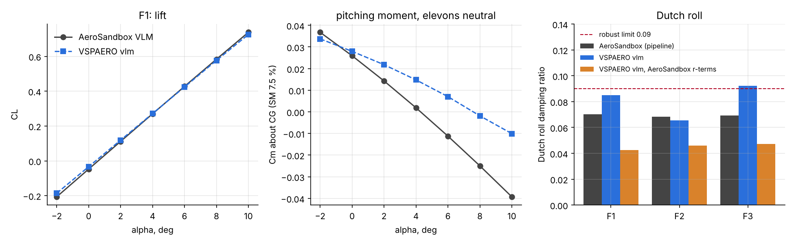

# VSPAERO check of the optimizer finalists (milestone M1.7)

## The short answer

| Question | Answer |
|---|---|
| Does Dutch roll damping hold up? | **No.** It is about **0.07**, not 0.09. Mostly that's because of a bug VSPAERO exposed in our own pipeline (below), not because VSPAERO disagrees with the VLM. Using VSPAERO's derivatives gives 0.04 to 0.09, depending on whose yaw-rate terms you trust. None of the three finalists reliably clears the 0.09 margin |
| What was the bug? | AeroSandbox's VLM rotates the aircraft about the geometry origin (the pod nose), not about the CG we pass in. So every pitch-rate and yaw-rate derivative was taken about a point 0.26 m ahead of the CG. CL_q came out at 13.5 instead of 4.6, and Cm_q 50 % too strong (-2.33 vs -1.57). The yaw-rate terms picked up a spurious sideslip that made yaw damping look better than it is. Fixed in `aero.run_vlm` (rates now turn about `xyz_ref`), with a regression test |
| Do lift and drag agree? | **Yes.** CL_alpha is within 4 % (PIPE-4 limit 10 %). VSPAERO's induced drag is about 40 % higher, which puts total cruise CD **11 % higher** (limit 20 %, so it passes). Expect cruise L/D around 14 to 15, not 16 |
| Does the neutral point agree? | **Only just.** VSPAERO puts it **3.0 to 3.2 % MAC further forward** (8 to 9 mm), right on the 3 % PIPE-4 limit. At the planned CG the real static margin would be about 4.5 %, not 7.5 % |
| What about the panel method? | **Failed.** OpenVSP's thick-surface mesh breaks where the fin meets the wing tip ("1 Faces have errors"), and the panel runs return nonsense (CL in the hundreds). They are rejected automatically. Thickness effects move to the CFD rung (M2.1), or to a panel rerun once the fin joint is re-modelled |
| Short period? | Still fine after the fix: damping 0.54 at 2.0 Hz |
| Recommendation | Re-run the M1.6 optimizer with the corrected rate derivatives before freezing the shape. In the meantime, plan the CG band **9 mm further forward** (about 252 to 266 mm) until CFD or flight test settles the neutral point |

## How it was run

OpenVSP can't be downloaded in the cloud environment, so the runs went on
Ethan's laptop (OpenVSP 3.57.1). Everything except the VSPAERO solve is in
the repo:

```bash
python -m manta_mapper.vspaero prepare config/mission.toml --out vsp_runs   # writes 18 .vspscript files
# on a machine with OpenVSP: vsp_runs/run_all.bat (or run_all.sh). VLM runs ~30 s, panel ~10 min
python -m manta_mapper.vspaero analyse config/mission.toml --runs vsp_runs \
    --report docs/vspaero_report.txt --json docs/vspaero_result.json --plots docs/img
```

Each finalist (F1 to F3 from `optimizer_result.json`) is rebuilt in OpenVSP
from the same AeroSandbox airplane the pipeline analyses. The analysis is at
cruise (14 m/s at survey altitude, design-day temperature), with the CG at
SM 7.5 % and the trimmed cruise alpha (5.6°), elevons neutral. Three runs per
design:

* **alpha sweep**, -2° to 10°: lift slope, neutral point, induced drag
* **stability run** (VSPAERO's built-in derivatives): roll, pitch and yaw rate terms
* **sideslip run**, ±4°: sideslip terms. VSPAERO's own stability run steps
  sideslip by only 0.01°, which is below its solver noise for a wing with
  fins this small (it even reports Cm changing with sideslip, which symmetry
  forbids), so those numbers are replaced.

Sign conventions aren't taken on trust. They are worked out from derivatives
whose sign is never in doubt (side force with sideslip, roll damping), and the
report states what was found. VSPAERO's moments are in the OpenVSP frame
(x aft, z up), and its rate derivatives are per p·b/2V about body axes.



## Results (F1, the optimum; F2 and F3 within a few %)

| | AeroSandbox VLM | VSPAERO VLM |
|---|---|---|
| CL_alpha, /rad | 4.54 | 4.37 |
| neutral point, % MAC | 34.4 | 31.2 |
| CDi at cruise CL | 0.0060 | 0.0084 |
| CD total at cruise (same profile drag) | 0.0225 | 0.0250 |
| CY_beta | -0.032 | -0.041 |
| Cl_beta (dihedral effect) | -0.056 | -0.082 |
| Cn_beta (weathercock) | 0.0069 | 0.0091 |
| Cl_p (roll damping) | -0.50 | -0.46 |
| Cl_r | 0.093 | 0.098 |
| Cn_r (yaw damping, inviscid) | -0.002 | -0.011 |
| Cm_q | -1.57 | -1.46 |

Dutch roll damping uses the same inertia (M1.5 build-up), the same profile-drag
yaw damping and the same trim for every row. The VSPAERO rows add VSPAERO
minus AeroSandbox, taken at identical conditions, to the pipeline's
derivatives:

| | F1 | F2 | F3 |
|---|---|---|---|
| M1.6 optimizer (before the fix) | 0.092 | 0.090 | 0.091 |
| AeroSandbox, rate bug fixed | **0.070** | **0.068** | **0.069** |
| VSPAERO derivatives | 0.085 | 0.066 | 0.092 |
| VSPAERO, but AeroSandbox yaw-rate terms | 0.043 | 0.046 | 0.047 |

How to read it: VSPAERO sees a **stronger dihedral effect** (Cl_beta 45 %
bigger), which on its own lowers Dutch roll damping. It also sees **much more
yaw damping** (Cn_r five times bigger), which raises it. The two codes agree
on the fin side force from yaw rate (CY_r), so the Cn_r gap is in the wing's
own contribution. VSPAERO's yaw-rate numbers come from its noisy built-in
stability run and scatter by about ±0.002 between three nearly identical
designs. That scatter is why the "VSPAERO" row jumps between 0.066 and 0.092.
The honest summary is: **0.07 ± 0.02, below the 0.09 margin.** VSPAERO also
makes the spiral mode stable (20 to 35 s to halve) where AeroSandbox has it
slowly divergent (21 to 24 s to double). Both are acceptable with an
autopilot holding the wings level.

## What would fix Dutch roll

A quick sweep on F1 with the corrected pipeline:

| change | Dutch roll | spiral (time to double) | fin ground clearance |
|---|---|---|---|
| none (F1) | 0.070 | 21 s | 26 mm |
| fins 85 → 100 mm | 0.079 | 14 s | 15 mm |
| fins 85 → 120 mm | 0.091 | 11 s | 1 mm |
| dihedral 4° → 2° | 0.089 | 11 s | 3 mm |
| dihedral 0° | 0.113 | 7 s | -21 mm |

Every fix trades against the spiral limit (≥ 12 s) and against fin ground
clearance (≥ 25 mm), so the optimizer has to re-balance them. That re-run is
the next step. If 0.09 turns out to be infeasible with drooped fins, the
options are relaxing the margin to the 0.08 handling-quality yardstick, or
widening the design space (less fin droop, or a deeper skid so longer fins
clear the ground).
