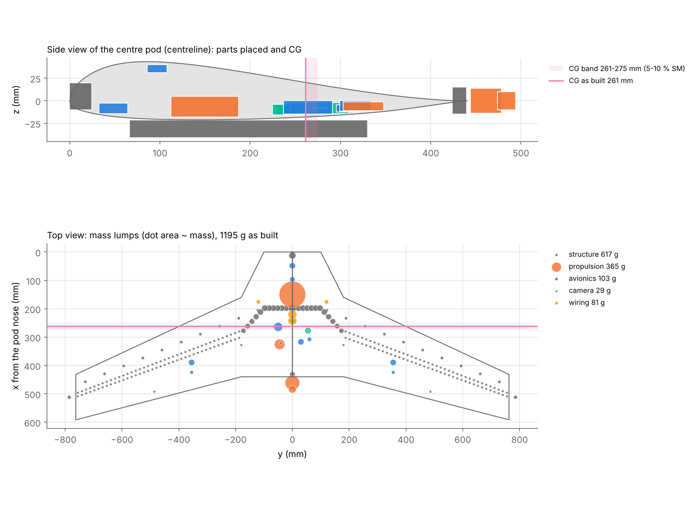
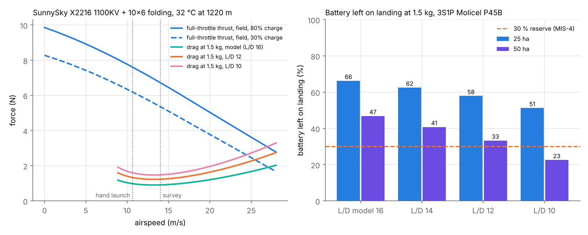

# Weights and propulsion (milestone M1.5)

## The short answer

| Question | Answer |
|---|---|
| What will it weigh? | **1.06 kg on paper, 1.20 kg as built** (with a growth allowance, see below). That is 0.3 kg under the 1.5 kg the wing was sized for |
| What does that buy? | Stall 7.9 m/s instead of 8.9 (AC-1 limit 9), wing loading 3.0 kg/m² (limit 6), and 0.3 kg of room for things that come out heavier than planned |
| Does the CG land in the band? | Yes, on **261 mm** (the 10 % static-margin end, for first flights) with the battery centred 150 mm from the pod nose. **No ballast.** Sliding the pack 71 mm aft covers the whole 261–275 mm band |
| Does everything fit? | Yes: every part sits where the pod is tall enough for it |
| Motor, prop, battery | **SunnySky X2216 1100KV**, **10x6 folding pusher prop**, **3S1P Molicel P45B** 21700 Li-ion (49 Wh), 40 A ESC |
| Hand launch on the hot day | Static thrust 0.67 × weight at 1.5 kg (0.84 as built). Climb-out gradient 0.41, four times the 0.15 needed |
| Climb with only the reserve left | 3.7 m/s at 1.5 kg with pessimistic drag (AC-5 needs 2.5) |
| Cruise power at 14 m/s | 33 W as built, 39 W at 1.5 kg, assuming L/D 12 (the model says 16) |
| 25 ha mission | Lands with **51–71 %** across every case (need 30 %) |
| 50 ha mission | Lands with **33–54 %**. One case falls short: 1.5 kg *and* L/D 10 at once (23 %) |
| Parts cost | **~$470** for the aircraft (BUD-1: $450–600), not counting radio, charger and spares |

Everything comes from one command, in about a minute and a half:

```bash
pip install -e ".[dev]"
python -m manta_mapper.weights config/mission.toml --plots docs/img --report docs/weights_report.txt
```

It prints the full report (saved in [weights_report.txt](weights_report.txt))
and draws the two plots on this page. `--quick` skips the vortex-lattice runs
(it uses the stored M1.4 polar) and the flight modes, and finishes in seconds.

## 1. The weight statement

Every part has a mass, a position and a price. Structure is worked out from
the M1.3 geometry: foam volume × foam density for the panels, printed shell
area × wall × filament density for the pod, tube length for the spar. Bought
parts use datasheet masses.

**Growth allowance.** Hobby builds nearly always weigh more than the
spreadsheet. Each item gets an allowance by how well its mass is known: 5 %
for bought parts, 20 % for structure estimated from geometry, 30 % for wiring,
glue and hardware. "As built" means with the allowance. That is the number the
scale gets compared with in VAL-4.

| Group | On paper | As built | What is in it |
|---|---|---|---|
| Structure | 522 g | 617 g | pod shell and frames 322 g, EPP panels + film 154 g, spar 67 g, skid, fins, nose cap |
| Propulsion | 348 g | 365 g | battery 237 g, motor 71 g, ESC 37 g, prop 20 g |
| Avionics | 98 g | 103 g | FC, GPS, airspeed, receiver, Remote ID, BEC, 2 servos + linkages |
| Camera | 28 g | 29 g | Pi Zero 2 W, Camera Module 3, SD card, tilted mount |
| Wiring, hardware | 62 g | 81 g | power and servo leads, connectors, magnets, bolts, velcro, glue |
| **Total** | **1058 g** | **1195 g** | |

The full line-by-line list, with x positions and prices, is in
[weights_report.txt](weights_report.txt).



### Build choices and why

**Outer panels: hot-wired EPP foam (1.9 lb/ft³), laminating film, carbon spar.**
The panels are all straight lines (M1.3), so a hot-wire cutter makes them from
two templates. EPP bends and springs back when a wingtip digs in during a
cartwheel. EPS dents and cracks, and XPS snaps. Both would mean panel repairs,
which AC-13 doesn't allow. EPP costs about 25 g more than EPS for the pair.
The catches: EPP cuts fuzzier (cut slowly with a hotter wire) and it is
floppy, so the film carries the torsion and a 3 × 1 mm carbon strip stiffens
each elevon.

| Panel core (both, as built) | Mass | Cost | Note |
|---|---|---|---|
| **EPP 1.9 lb/ft³ (chosen)** | 126 g | $23 | springs back after impacts |
| EPP 1.3 lb/ft³ | 88 g | $22 | lighter, floppier; elevons and twist harder to hold |
| EPS 1.5 lb/ft³ | 101 g | $21 | cheap, clean cut; dents and cracks |
| XPS (Foamular 150) | 117 g | $21 | stiff, clean cut; snaps in a cartwheel |

**Centre pod: printed LW-ASA (foamed ASA), 0.8 mm walls.** The skid takes the
belly landings and the TPU nose cap takes nose-ins, so the pod mainly has to be
stiff, hold the spar sockets and survive being left in a car. That last part
rules out PLA and LW-PLA: they soften around 55–60 °C, and a parked car in a
Las Cruces summer goes well past that. ASA holds to about 95 °C and doesn't
yellow in sunlight. The K2 Pro's heated enclosure prints it.

| Pod shell (as built, incl. internal frames at +60 %) | Mass | Filament | Softens |
|---|---|---|---|
| LW-PLA 0.6 mm | 207 g | $10 | ~55 °C ✗ |
| **LW-ASA 0.8 mm (chosen)** | 322 g | $19 | ~95 °C |
| ASA 0.8 mm | 493 g | $9 | ~95 °C |
| PETG 0.8 mm | 585 g | $9 | ~75 °C |

Plain ASA is a fine fallback if LW-ASA is hard to dial in. It adds 170 g,
which the 0.3 kg margin covers. The pod is the biggest single structural item
and the least certain one, so M2.4 (test prints) should weigh a pod section
early and feed the real number back.

**Throwaway parts.** Tip fins and the belly skid are EPP, held on with tape,
pegs and velcro. The skid gets an HDPE wear strip for the desert dirt. The
nose cap is TPU. Together they cost a few dollars, so keep spares.

**Elevon servos in the panels.** Each servo sits about 30 % of the way out,
just ahead of the hinge, with a plug at the panel root so a panel comes off
without cutting wires.

### Where things go, and the CG

Positions are set as fractions of the pod chord, so they follow the geometry
when the optimizer changes it. From the nose back:

- nose cap; airspeed sensor (pitot out the nose, in clean air ahead of the pusher)
- GPS + compass under the top hatch, forward, away from the power wires
- **battery**: the one big part that can slide. The code places it to put the
  CG on the target, at 150 mm. It physically fits anywhere from 49 to 252 mm
- camera on its 6° wedge (CAM-4) at 242 mm, right next to the CG so pitch
  wobble barely moves the photo centre; Pi Zero beside it
- flight controller beside the camera at 264 mm, close to the CG
  where the IMU wants to be
- receiver, Remote ID, Pi BEC, then the ESC near the trailing edge
- motor and prop behind the trailing edge

The CG comes out at x = 261 mm, 1 mm off the centreline (the FC and ESC sit to one
side; nudge the pack to square it), with no nose ballast. Moving the pack 10 mm moves the CG 2 mm, so:

- first flights: pack at 150 mm, CG 261 mm (10 % static margin)
- the design CG of 268 mm (7.5 %): pack about 35 mm further aft
- the aft limit of 275 mm (5 %): pack about 71 mm further aft

Mark those positions on the battery tray.

## 2. Inertia: the placeholder is gone

The moments of inertia are now summed from the parts above, with panels,
shell and spar split into strips. M1.4 had used a rough guess.

| | Ixx (roll) | Iyy (pitch) | Izz (yaw) | kg m² |
|---|---|---|---|---|
| M1.4 placeholder at 1.5 kg | 0.101 | 0.023 | 0.123 | |
| **Build-up, scaled to 1.5 kg** | **0.079** | **0.027** | **0.105** | |
| Build-up as built (1.20 kg) | 0.063 | 0.021 | 0.084 | |

The guess had too much mass far out on the wing (roll inertia 27 % high) and
too little spread fore and aft (pitch 18 % low). The battery is forward and the
motor is far aft. What that changes, at the design mass and the CG target:

| Mode | With the placeholder | With the build-up |
|---|---|---|
| Short period | 1.98 Hz, damping 0.64 | **1.84 Hz, damping 0.63** |
| Dutch roll damping | 0.053 | **0.072** (as built: 0.079) |
| Spiral | — | doubles in 23 s (as built 46 s) |

Good news on the one watch item from M1.4: with the real (lower) roll
inertia, the **Dutch roll damping rises from 0.05 to 0.07–0.08**, about at the
0.08 yardstick. It's still worth keeping "≥ 0.08" as an optimizer constraint,
but it no longer looks like it needs much bigger fins.
[aero_stability.md](aero_stability.md) and
[stability_report.txt](stability_report.txt) were rerun with the new inertia.

## 3. Propulsion

### How the parts are picked

The model chains four simple pieces (`src/manta_mapper/propulsion.py`):

1. **Drag** from the M1.4 trimmed polar, refitted at the CG target, then
   scaled up so the best L/D is 14, 12 or 10 instead of the model's 16.
   Small printed flying wings usually measure 10–14, and the model can't see
   prop wash, leaky hatches or wavy skins. **L/D 12 is the planning case and
   L/D 10 the pessimistic one.**
2. **Propeller**: blade-element momentum theory on a generic thin-electric
   blade, narrowed 15 % for folding blades. It is checked against published
   thin-electric prop data (static thrust and power coefficients, peak
   efficiency, the advance ratio where thrust runs out). Torque is raised 15 %
   for what the strip model leaves out (swirl, hub, rough nylon blades), and
   pusher thrust is cut 10 % for the pod wake. Both are on the cautious side.
3. **Motor**: the standard Kv / resistance / no-load-current model that
   datasheets and eCalc use.
4. **Battery**: Li-ion voltage curve and internal resistance per cell, plus
   wiring. 85 % of nominal energy counts as usable.

Every motor × prop × pack in a small catalogue of common, cheap hobby parts
(6 motors, 5 folding props, 5 packs: 150 combinations) is checked at the
**1.5 kg design mass in the 32 °C, 1220 m design-day air**:

| Check | Requirement | Chosen set |
|---|---|---|
| Static thrust / weight (80 % charge) | ≥ 0.6 (forgiving hand launches) | 0.67 |
| Climb-out gradient at 1.2 Vs, L/D 10 | ≥ 0.15 (AC-6) | 0.41 |
| Climb rate, 30 % charge, L/D 10 | ≥ 2.5 m/s (AC-5) | 3.7 m/s |
| Level top speed, 30 % charge, L/D 10 | ≥ 1.15 × fastest survey speed (22 m/s) | 24.4 m/s |
| Motor current | ≤ 90 % of rating | 22.6 of 26 A |
| Cell current | ≤ 80 % of rating | 23 of 45 A |
| ESC current | ≤ 75 % of rating | 23 of 40 A |
| Pack size (MIS-4a) | ≥ 1.25 × the 50 ha energy on the model polar, with reserve | 41.3 vs 39.2 Wh |
| 50 ha at L/D 12 | lands with ≥ 30 % | 33 % |
| 25 ha at L/D 10 | lands with ≥ 30 % | 51 % |

Then it takes the cheapest set within 8 % of the lowest cruise power.

**Only one set in the catalogue passes everything.** The cheap generic A2212
1000KV motor is the near miss. On a 10x7 it gives 0.57–0.59 thrust/weight,
but it pulls more than its 15 A rating, so it would run hot on every launch.
The X2216 costs about $18 more and has real headroom. A 3S2P pack would carry
50 ha even in the worst case, but it adds 230 g and isn't needed for the
25 ha requirement. It stays an option for later.



### The chosen set

| Part | Mass | ~Price | Notes |
|---|---|---|---|
| SunnySky X2216 1100KV | 68 g | $27 | reverse rotation for the pusher; check the shaft size against the prop yoke |
| 10x6 folding prop, 40 mm yoke + spinner | 19 g | $10 | blades fold back when the motor stops, so they survive belly landings; buy spare blades |
| 3S1P Molicel P45B 21700 | 226 g | $29 | 49 Wh nominal, 45 A cells; Li-ion charger profile (4.2 V/cell); keep it warm in winter |
| 40 A BLHeli_S ESC | 35 g | $18 | 30 A would be at 77 % on the hot day; 40 A keeps it cool in a closed pod |

Operating points on the design day (pessimistic for launch and climb, planning
drag for cruise):

| | 1.5 kg | As built (1.20 kg) |
|---|---|---|
| Static thrust, 80 % charge | 9.9 N, 237 W, 22 A | same thrust, T/W 0.84 |
| Hand launch, full throttle | 7.6 N at 10.6 m/s | 7.9 N at 9.5 m/s |
| Cruise 14 m/s, L/D 12 | 39 W, 3.5 A, 53 % throttle | 33 W, 2.9 A, 51 % throttle |
| Fastest survey speed (19 m/s) | 67 W | 63 W |

Overall propulsive efficiency at cruise is about 0.45 (prop × motor × ESC ×
pusher). That's low because the prop is sized for launch and so runs lightly
loaded in cruise. VAL-2 (cruise power from the battery log) is what will
correct it.

## 4. Missions

Survey at 14 m/s, 5 m/s wind along the lines, portrait camera, 4 minutes of
launch, climb, transit and landing (climb at full throttle), 6 W of avionics
through the BECs. Battery left on landing (need ≥ 30 %):

| Mass | Drag case | 25 ha (21 min) | 50 ha (34 min) |
|---|---|---|---|
| 1.20 kg as built | model (L/D 16) | 71 % | 54 % |
| | L/D 14 | 68 % | 49 % |
| | **L/D 12 (planning)** | **64 %** | **43 %** |
| | L/D 10 (pessimistic) | 59 % | 34 % |
| 1.5 kg design mass | model | 66 % | 47 % |
| | L/D 14 | 62 % | 41 % |
| | L/D 12 | 58 % | 33 % |
| | L/D 10 | 51 % | 23 % ✗ |

- **25 ha (the requirement)** passes with a lot to spare in every case. Even
  heavy and draggy, it lands with half the pack left.
- **50 ha (the stretch)** passes at the expected weight even with pessimistic
  drag. It is short only if the aircraft is both 300 g overweight *and* at
  the bottom of the L/D range. The first glide tests (VAL-1) and the scale will
  show long before a 50 ha attempt whether that corner is real.
- Endurance at 14 m/s down to the 30 % reserve: 44 min as built at L/D 12
  (38–55 min across the drag cases).
- Cold days: Li-ion gives up roughly 10–20 % of capacity near 0 °C. 25 ha
  still has ample margin. For a winter 50 ha flight, keep the pack warm and
  check the numbers against the measured cruise power first.

## 5. Cost

| | ~$ |
|---|---|
| Structure (EPP, film, carbon, LW-ASA, TPU, skid, fins) | 85 |
| Propulsion (motor, prop, pack, ESC) | 84 |
| Avionics (FC, GPS, airspeed, ELRS receiver, Remote ID, BEC, servos) | 219 |
| Camera (Pi Zero 2 W, Camera Module 3, SD card) | 54 |
| Wiring and hardware | 27 |
| **Aircraft total** | **~470** |

Not included: radio (an ELRS transmitter such as a RadioMaster Pocket, ~$70),
a charger that does Li-ion, a hot-wire cutter (easy to build), and spares
(skids, fins, nose caps, prop blades: about $20 for a season). Prices are
rough late-2026 US street prices and drift, so treat them as a budget check,
not a quote. Avionics is the biggest share. Airspeed ($45) and Remote ID
($45) are fixed by the requirements, so the FC is the one place to save, for
example with a cheaper ArduPilot-supported F405 wing board.

## What this changes downstream

- **M1.6 optimizer**: the weight model and the propulsion checks are now
  functions of the geometry, so the optimizer can use real masses. With
  1.20 kg as built, it could shrink the wing about 20 %. Recommendation: keep
  sizing at 1.5 kg for now. The 0.3 kg buys margin on the least certain
  numbers (pod mass, drag) and a slower hand launch.
- **M2.2 structure**: the spar is a 10 × 8 mm carbon tube per panel with a
  100 mm pod socket. Size it there for AC-10.
- **M2.4 test prints**: weigh a printed pod section and an EPP panel first;
  they are the two least certain items.
- **Flight tests**: VAL-4 compares the scale against 1195 g and the CG
  against 261 mm. VAL-2 compares cruise power against 33 W at L/D 12 (25 W if
  the model's L/D 16 turns out right).

## Limits

- Prices, masses and motor constants are typical catalogue values. Check
  them before buying.
- The propeller model is generic, not the exact folding blade. It is
  calibrated on the cautious side, and VAL-2 will correct it.
- Thrust-line offset (motor slightly above the CG) and prop-wash effects on
  trim are not modelled. Check them in the glide and powered tests (M3.3/3.4).
- Packing is checked on the pod centreline only. The scripted CAD (M2.3) does
  the real packing.
